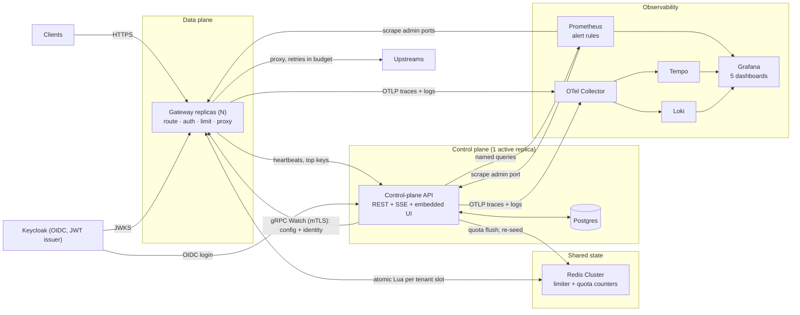
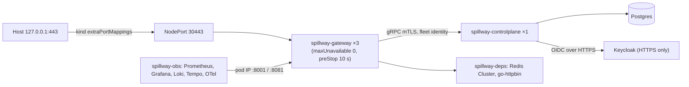

# Spillway

A horizontally scalable API gateway in Go with a Redis-backed distributed rate limiter, a Postgres-backed control plane and a React admin UI.

Status: M0 (foundations) to M6 (admin UI) are done. M7 (performance and hardening) is done apart from release v1.0.0: the deny cache, token leasing, quotas, the per-client connection cap, the pprof pass, the nightly benchmark gate, the load and chaos suites, the kind cluster, the Helm chart, observability as code, and `make verify-m7`, the M7 exit (see [verify-m7 results](#verify-m7-results)). NFR-02 (scaling) is an open known limit; see [Known limits](#known-limits).

- [Requirements and build plan](docs/design.md)
- [Prerequisites and setup](docs/setup.md)
- [Ports](docs/ports.md)
- [Architecture decision records](docs/adr/)
- [Runbooks](docs/runbooks/)

Contents: [Architecture](#architecture) · [Quick start](#quick-start) · [NFR status](#nfr-status) · [Benchmark report](#benchmark-report) · [Accuracy report](#accuracy-report) · [Chaos report](#chaos-report) · [Admin UI](#admin-ui) · [Observability](#observability) · [Known limits](#known-limits) · [verify-m7 results](#verify-m7-results)

Every number below was measured by a check in this repository. Each one names its commit, date and source: a merged PR, an ADR, or a result file on the [`bench-results`](https://github.com/ankitbisht23/spillway/tree/bench-results) branch. "Laptop" means the dev machine: Apple silicon (M4 Pro), Docker Desktop with 14 CPUs and about 8.3 GB of memory. Host and Docker VM stalls on that machine are usually 4–9 ms and sometimes 100–820 ms (ADR-0027, ADR-0034). Each check's tolerance is chosen with those stalls in mind. Where a stall can still fail a check, the report says so (see [Known limits](#known-limits)). No rule re-runs a check after a FAIL; the one re-dispatch the user authorized is reported where it happened.

## Architecture

Stateless gateway replicas are the data plane. A Go control-plane API over Postgres is the control plane. Redis Cluster holds only rate-limit and quota state ([Architecture](docs/design.md#architecture)).



How a request flows through a gateway: TLS, then the request ID and trace context, then route match (radix tree). Next come IP flood limits and the CIDR denylist, then authentication (API key or JWT) and allow and deny lists, then local limiters. The global limiters run last: the deny cache and token leases first (RL-19, RL-18), then one atomic Redis script per tenant slot covering the tenant, consumer and route levels and the consumer's quotas (RL-10), then the global level. Then the upstream circuit breaker, a load-balanced endpoint, the proxy with per-try timeouts and budgeted retries, and finally RateLimit headers, metrics, a span and an access log line.

Key choices:

- Limiter decisions use Redis server time, never a gateway's clock.
- Accuracy versus latency is chosen per policy: strict (one Redis call per decision) or batched (leases of `lease_k` tokens, over-admission at most replicas × k).
- Failure behaviour is chosen per policy: `fail_open`, `fail_closed` or `degraded` (local limiting with the limit split across live replicas). Readiness never depends on Redis.
- Config is published as reviewed, versioned snapshots that can be rolled back. Identity changes (keys, revocations, blocks) apply at once. Gateways keep serving their last good snapshot, also from disk after a restart, while the control plane is down.

Deployments:

- **Compose (dev):** every process is a compose service. gateway-1 is published on the host and gateway-2 … gateway-5 run under the `replicas` profile. The stack includes the Redis Cluster (3 primaries, 3 replicas), Postgres, Keycloak, the observability stack and mock upstreams (ADR-0004).
- **kind (M7):** a 3-node cluster named `spillway`. The Helm chart `deploy/helm/spillway` installs 3 gateways, 1 control plane and a migrate hook Job into namespace `spillway`. The dependencies live in `spillway-deps` and the observability stack in `spillway-obs`, all from plain manifests in `deploy/kind/`. There is no ingress controller: the gateway is the edge, a NodePort that kind maps to `127.0.0.1:443` only. Admin ports are reachable only on pod IPs, behind NetworkPolicies that admit Prometheus and the kubelet. Pods run non-root with read-only root filesystems, and Secrets are mounted as files (GW-25, SEC-04, SEC-06, ADR-0085, ADR-0086).



## Quick start

Prerequisites, accounts and the pinned toolchain are in [docs/setup.md](docs/setup.md). `make tools` installs every project tool into `./bin` at pinned versions, including kind, kubectl and helm. Run `pnpm install` once after cloning.

**Compose (dev):**

```sh
make tools && make hooks && pnpm install
make dev                                   # docker compose up -d --wait; mints dev certs
curl --cacert "$(bin/mkcert -CAROOT)/rootCA.pem" https://localhost:8443/bytes/16
# admin UI: http://localhost:8080/ (Keycloak dev realm login); Grafana: http://localhost:3000/ (Spillway / Overview …)
docker compose down                        # stop; add -v to also wipe the volumes
```

**kind (production-shaped, M7):** kind and compose are never run together because of memory: the cluster needs about 5.75 GB. Stop compose first (`docker compose down`, without `-v`).

```sh
docker compose down
make kind-up        # cluster, dependencies, observability, images, Helm chart, seed config (about 2 min)
make kind-smoke     # PASS/FAIL checks: nodes, pods, edge on 127.0.0.1:443 only, NetworkPolicies, Keycloak over HTTPS, rules, dashboards
curl --cacert "$(bin/mkcert -CAROOT)/rootCA.pem" https://127.0.0.1:443/bytes/16
make kind-rollout   # NFR-14: rolling restart of the gateways under 300 rps, zero failed requests
make kind-grafana   # Grafana on 127.0.0.1:13000 (Ctrl-C to stop); make kind-prometheus on 19091
make kind-down && make dev
```

The Makefile always passes `--context kind-spillway` to kubectl and `--kube-context kind-spillway` to helm, and keeps the cluster in its own kubeconfig, `~/.kube/spillway-kind`. Measured on the laptop on 2026-11-26 (ADR-0086, ADR-0087): `make kind-up` takes 106–146 s from nothing, `make kind-smoke` 12–14 s and `make kind-down` 1–2 s, with 9 of 9 recorded cycles PASS (one earlier `make kind-up` failed before a seed-Job fix, ADR-0086).

## NFR status

The latest recorded measurement of each NFR row ([Non-functional requirements](docs/design.md#non-functional-requirements)). The M7 exit, `make verify-m7` (ADR-0074), re-measures every row on one commit and writes its table under [verify-m7 results](#verify-m7-results). This table collects the numbers recorded by the checks before it. Rows measured on a task branch name the merged PR and its main commit.

| NFR | Target (abridged) | Latest recorded | Source | Reproduce |
| --- | --- | --- | --- | --- |
| NFR-01 throughput | ≥ 4,600 rps per gateway vCPU on x64, ≥ 8,800 on arm64, any CPU model | Met on both arches: x64 4,600 valid on three CPU models; arm64 8,800 valid in 2 of 3 M7 run sets | [Benchmark report](#benchmark-report) | `gh workflow run bench.yml` |
| NFR-02 scaling | within 15% of linear from 1 to 2 gateway vCPUs (S ≥ 1.70) | **Open known limit**: 0 of 2 dispatches valid; would-be S x64 2.013, arm64 1.517 | ADR-0084, #94 | `gh workflow run bench.yml -f mode=scaling` |
| NFR-03 added latency, local limits | p99 ≤ 2 ms | 0.282 ms added (laptop) | #91 (m7-perf, main cfebf6a), 2026-11-25 | `make verify-m2` |
| NFR-04 added latency, Redis check | p99 ≤ 5 ms | 0.262 ms added (laptop) | #91, 2026-11-25 | `make verify-m3` |
| NFR-05 regression gate | no confirmed > 10% regression, same CPU model | Gate live (nightly 03:17 UTC). First gated runs: `first` on both arches, so nothing was compared yet | ADR-0081, #92 | `gh workflow run bench.yml -f gate=true` |
| NFR-06 accuracy, strict | zero over-admission (GCRA bound) | 0 at 1, 3 and 5 replicas in every recorded run | [Accuracy report](#accuracy-report) | `make accuracy REPLICAS=<n>` |
| NFR-07 accuracy, batched | over-admission ≤ replicas × k | max 3–6 of 10, 12–21 of 30, 3–7 of 50; 18 of 18 runs PASS | #87, 2026-11-24 | `make accuracy REPLICAS=<n> MODE=batched` |
| NFR-08 config propagation | p99 < 5 s | UI click to the last of 5 replicas: p99 54–58 ms, 3 of 3 PASS | #89 (main 4487160), 2026-11-25 | `make verify-m6` |
| NFR-09 key revocation | < 5 s on all replicas | max 54–59 ms, 7 of 7 PASS | #62 (2acad8d), 2026-11-14 | `make verify-m5` |
| NFR-10 limiter keys | ≥ 1M keys, ≤ 200 B per key | GCRA 118.2–118.9 B, sliding window 157.0–157.7 B at 1M keys; 3 of 3 PASS each | ADR-0083, #93 (3b31a27), 2026-11-25 | `make nfr-keys` |
| NFR-11 availability | gateway-caused 5xx ≤ 0.1% | 0 of 1,260,000 in each of 3 soaks; 3 of 3 PASS | ADR-0083, #93, 2026-11-25 | `make nfr-soak` |
| NFR-12 control-plane outage | zero failed, config frozen | 0 failed of 347,870–347,920 over 10 min; staleness alert fired at +65/+71/+81 s; 3 of 3 PASS | ADR-0087, #97 (f33deff), 2026-11-26 | `make chaos-cp-outage` |
| NFR-13 Redis outage | failure mode within one budget | see [Chaos report](#chaos-report); compose chaos suite 1 of 1 PASS | ADR-0083, #93 | `make chaos-redis-outage`, `make chaos-redis-primary` |
| NFR-14 deploys and reloads | zero failed requests | rolling restart on kind: 0 failed of 72,000, 7 of 7 PASS; reload: 60,000/60,000 2xx over 29 swaps | ADR-0086, #96 (9d853e6), 2026-11-26; #15 (bf4fc74), 2026-11-04 | `make kind-rollout`, `make verify-m1-reload` |
| NFR-15 tenant isolation | one tenant at 10× its limit raises others' p99 by < 10% | median p99 ratio (on ÷ off) 0.337–0.378, 3 of 3 PASS | ADR-0083, #93, 2026-11-25 | `make nfr-noisy` |

## Benchmark report

Method ([Benchmark method](docs/design.md#benchmark-method), ADR-0015, ADR-0016, ADR-0073):

- `bench.yml` runs on GitHub's 4-vCPU public runners: x64 `ubuntu-latest` and arm64 `ubuntu-24.04-arm`.
- The gateway is pinned to 1 vCPU, uses plain HTTP/1.1 and serves 1 KB responses from go-httpbin. loadgen sends at a constant arrival rate (open model).
- A run set is 5 runs, each 30 s warm-up plus 3 min measured. Figures are medians, with the range across the runs in brackets.
- A run set is valid only if every run reached 99% of its target rate.
- Every result records the runner's CPU model. GitHub's x64 pool rotates models: AMD EPYC 7763, AMD EPYC 9V45, AMD EPYC 9V74 and Intel Xeon Platinum 8370C have been seen (ADR-0080, ADR-0081).

### NFR-01: throughput floors

NFR-01 was re-baselined from ≥ 10k to per-arch floors by the user's decision: P19, ADR-0080. A floor counts on whatever CPU model the runner has (ADR-0082). Every valid and invalid run set at the floors:

| Arch | CPU model | Commit (PR) | Date | Run | Valid | rps per gateway vCPU | p50 | p99 | p99.9 | Result file |
| --- | --- | --- | --- | --- | --- | --- | --- | --- | --- | --- |
| x64 | AMD EPYC 7763 | 1310f0c (main, M1 baseline) | 2026-11-04 | [41817046132](https://github.com/ankitbisht23/spillway/actions/runs/41817046132) | yes | 4,600 (4,600 – 4,600) | 0.63 ms (0.58 – 0.64) | 2.68 ms (2.33 – 2.99) | 4.21 ms (3.64 – 8.94) | [x64/20261104T105219Z](https://github.com/ankitbisht23/spillway/blob/bench-results/results/x64/20261104T105219Z.json) |
| x64 | AMD EPYC 9V45 | 8573118 (m7-perf, #91) | 2026-11-25 | [45593397217](https://github.com/ankitbisht23/spillway/actions/runs/45593397217) | yes | 4,600 (4,600 – 4,600) | 0.59 ms (0.58 – 0.60) | 2.70 ms (2.43 – 3.03) | 19.8 ms (18.1 – 25.5) | [x64/20261125T101635Z](https://github.com/ankitbisht23/spillway/blob/bench-results/results/x64/20261125T101635Z.json) |
| x64 | Intel Xeon Platinum 8370C | 8573118 (m7-perf, #91) | 2026-11-25 | [45596685407](https://github.com/ankitbisht23/spillway/actions/runs/45596685407) | yes | 4,600 (4,600 – 4,600) | 0.37 ms (0.37 – 0.38) | 2.44 ms (2.18 – 2.60) | 5.24 ms (4.36 – 17.8) | [x64/20261125T103707Z](https://github.com/ankitbisht23/spillway/blob/bench-results/results/x64/20261125T103707Z.json) |
| x64 | AMD EPYC 7763 | 9cf765b (m7-bench-gate, #92) | 2026-11-25 | [45614374834](https://github.com/ankitbisht23/spillway/actions/runs/45614374834) | yes | 4,600 (4,600 – 4,600) | 0.53 ms (0.53 – 0.54) | 5.41 ms (5.37 – 5.76) | 9.95 ms (8.96 – 10.6) | [x64/20261125T123031Z](https://github.com/ankitbisht23/spillway/blob/bench-results/results/x64/20261125T123031Z.json) |
| arm64 | Neoverse N2 (`implementer 0x41 part 0xd49`) | 1310f0c (main, M1 baseline) | 2026-11-04 | [41817046132](https://github.com/ankitbisht23/spillway/actions/runs/41817046132) | yes | 8,800 (8,764 – 8,800) | 0.90 ms (0.85 – 41.6) | 47.1 ms (3.21 ms – 1.19 s) | 69.1 ms (12.3 ms – 1.20 s) | [arm64/20261104T105228Z](https://github.com/ankitbisht23/spillway/blob/bench-results/results/arm64/20261104T105228Z.json) |
| arm64 | Neoverse N2 | 8573118 (m7-perf, #91) | 2026-11-25 | [45593397217](https://github.com/ankitbisht23/spillway/actions/runs/45593397217) | **no**: run 3 reached 8,651 (needs 8,712) | 8,800 (8,651 – 8,800) | 4.21 ms (2.13 ms – 1.14 s) | 270 ms (80.2 ms – 1.23 s) | 279 ms (130 ms – 1.26 s) | [arm64/20261125T101637Z](https://github.com/ankitbisht23/spillway/blob/bench-results/results/arm64/20261125T101637Z.json) |
| arm64 | Neoverse N2 | 8573118 (m7-perf, #91) | 2026-11-25 | [45596685407](https://github.com/ankitbisht23/spillway/actions/runs/45596685407) | yes | 8,800 (8,800 – 8,800) | 0.49 ms (0.45 – 0.54) | 13.0 ms (7.69 – 20.8) | 34.2 ms (14.3 – 74.6) | [arm64/20261125T103709Z](https://github.com/ankitbisht23/spillway/blob/bench-results/results/arm64/20261125T103709Z.json) |
| arm64 | Neoverse N2 | 9cf765b (m7-bench-gate, #92) | 2026-11-25 | [45614374834](https://github.com/ankitbisht23/spillway/actions/runs/45614374834) | yes | 8,800 (8,800 – 8,800) | 0.43 ms (0.42 – 0.43) | 7.01 ms (6.77 – 7.22) | 9.54 ms (9.38 – 12.1) | [arm64/20261125T123034Z](https://github.com/ankitbisht23/spillway/blob/bench-results/results/arm64/20261125T123034Z.json) |

Run 45596685407 re-dispatched the whole run set after the invalid arm64 set. That re-dispatch was a one-off the user authorized, not a rule (ADR-0080), and the invalid set stays stored as invalid. Branch results are never baselines (ADR-0003). On x64, the gateway's CPU 0 and loadgen's CPU 1 are SMT threads of one core.

**Capacity** (information only): each run set targets 20,000 rps per vCPU, so the gateway saturates and the sets are invalid by design. Capacity is compared only within one CPU model (ADR-0016):

| Arch | CPU model | M1, 7e404da (2026-11-04) | main before the pprof pass, c490e68 (2026-11-25) | after the pass, 8573118 (#91, 2026-11-25) |
| --- | --- | --- | --- | --- |
| arm64 | Neoverse N2 | 9,924 (9,796 – 9,975), [result](https://github.com/ankitbisht23/spillway/blob/bench-results/results/arm64/20261104T094904Z.json) | 7,070 (7,049 – 7,130), [result](https://github.com/ankitbisht23/spillway/blob/bench-results/results/arm64/20261125T080625Z.json) | **10,889** (10,797 – 11,015), [result](https://github.com/ankitbisht23/spillway/blob/bench-results/results/arm64/20261125T101644Z.json) |
| x64 | AMD EPYC 7763 | 5,369 (5,164 – 5,529), [result](https://github.com/ankitbisht23/spillway/blob/bench-results/results/x64/20261104T094901Z.json) | 5,208 (4,974 – 5,291), [result](https://github.com/ankitbisht23/spillway/blob/bench-results/results/x64/20261125T080624Z.json) | no run landed on this model |
| x64 | AMD EPYC 9V45 | — | — | 14,325 (14,008 – 14,893), [result](https://github.com/ankitbisht23/spillway/blob/bench-results/results/x64/20261125T101641Z.json) |

The M1 run (7e404da) targeted 10,000 rps rather than 20,000. **The pprof pass** (ADR-0080, #91) reuses the proxy's 32 KB copy buffers through a tested `sync.Pool`, canonicalises header names, and skips per-request allocations in the Redis phase. Results, all with p = 0.000:

- `BenchmarkServeHTTP` (benchstat, 10 runs, laptop): sec/op −7.7 to −10.1%, B/op −68 to −72% (for example plain 44.58 → 12.70 KiB), allocs/op −1.4 to −6.2% (plain 140 → 138, lease 177 → 166).
- arm64 capacity on the same CPU model: 7,070 → 10,889 rps per vCPU (+54%).

### NFR-02: scaling (open known limit)

`bench.yml -f mode=scaling` runs `test/load/scaling.sh` on both runners. The gateway runs on CPU 0, then on CPUs 0 and 2. loadgen and a no-op upstream (`loadgen serve`) share CPUs 1 and 3, and there is no Redis (ADR-0083, ADR-0084). A result is valid only if every probe is gateway-bound: the gateway uses ≥ 0.95 × n vCPU, and loadgen plus the upstream together use ≤ 1.80. The pass rule is S = R(2) ÷ R(1) ≥ 1.70 on each arch.

| Run (commit, date) | Arch, CPU model | R(1) → R(2) rps | Would-be S | Why invalid | Result file |
| --- | --- | --- | --- | --- | --- |
| [45626436921](https://github.com/ankitbisht23/spillway/actions/runs/45626436921) (a3a0c87, #93, 2026-11-25), old layout | x64, AMD EPYC 9V74 | 7,900 → 15,400 | 1.949 | n = 2: loadgen at 0.93–0.94 vCPU (> 0.90), gateway at 1.70–1.71 | [x64/20261125T134322Z](https://github.com/ankitbisht23/spillway/blob/bench-results/results/x64/20261125T134322Z.json) |
| same | arm64, Neoverse N2 | 10,500 → 17,300 | 1.648 | gateway at 0.947–0.949 (n = 1) and 1.69–1.70 (n = 2) | [arm64/20261125T134322Z](https://github.com/ankitbisht23/spillway/blob/bench-results/results/arm64/20261125T134322Z.json) |
| [45661905238](https://github.com/ankitbisht23/spillway/actions/runs/45661905238) (d488f06, #94, 2026-11-25), shared CPUs | x64, AMD EPYC 9V74 | 7,900 → 15,900 | 2.013 | n = 2: gateway at 1.758–1.780 (< 1.90) | [x64/20261125T171042Z](https://github.com/ankitbisht23/spillway/blob/bench-results/results/x64/20261125T171042Z.json) |
| same | arm64, Neoverse N2 | 11,800 → 17,900 | **1.517** | n = 2: gateway at 1.834–1.846 (< 1.90) | [arm64/20261125T171047Z](https://github.com/ankitbisht23/spillway/blob/bench-results/results/arm64/20261125T171047Z.json) |

The n = 1 probes are gateway-bound on both arches since the probes' 400 in-flight cap. Profiling found two things (ADR-0084 §2):

- With two Ps on two CPUs, each gateway CPU sits 5–6% idle while threads wait in the run queue. `GOMAXPROCS=4` reached 1.90–1.92 vCPU in a diagnostic run, but was not applied.
- On arm64, gateway CPU per answer grows from about 84–88 µs at n = 1 to about 93 µs at n = 2. That alone keeps S near or below 1.70.

The user decided to leave NFR-02 as an **open known limit** for M7: not passed and not failed, because no valid result exists. Nothing is re-run and nothing is re-baselined.

### NFR-05: regression gate

`bench.yml` runs nightly at 03:17 UTC on `main` with the gate on (ADR-0073 §D8, ADR-0081). `cmd/benchgate` compares the median throughput and p99 with the newest gated, valid `main` result that has the same arch, CPU model, target rate and setup, and with the last release's baseline. A run is flagged when the change is > 10% and also exceeds the baseline's run-to-run spread. A flagged set re-runs once in the same job and fails only if the re-run confirms it. When there is no same-model baseline, the verdict is `first`; the gate then also shows an information-only comparison with another CPU model's baseline (P34, ADR-0083). Failed and branch results never become baselines.

The first gated runs were on the m7-bench-gate branch (9cf765b, [run 45614374834](https://github.com/ankitbisht23/spillway/actions/runs/45614374834), 2026-11-25). Both arches got `first`, because the M1 baselines predate the recorded `trace_sample_ratio` and so do not compare (ADR-0081 choice 1). The first nightly on `main` was due at 03:17 UTC on 2026-11-26, but GitHub started no scheduled run that night (the repository has no scheduled runs at all), so `bench-results` holds no gated `main` result to compare with. verify-m7's three dispatches on m7-verify (067dbd2: runs [45755559828](https://github.com/ankitbisht23/spillway/actions/runs/45755559828), [45765073716](https://github.com/ankitbisht23/spillway/actions/runs/45765073716), [45775387596](https://github.com/ankitbisht23/spillway/actions/runs/45775387596)) were valid at the floors on both arches and all got `first`. **No comparison has been made yet**, so NFR-05 has not yet been demonstrated. verify-m7 counts `first` as a FAIL (ADR-0074).

### Reproduce

```sh
gh workflow run bench.yml --ref <branch>                                     # NFR-01 at the floors, both arches (about 30 min)
gh workflow run bench.yml --ref <branch> -f rate_x64=20000 -f rate_arm64=20000  # capacity, information only
gh workflow run bench.yml --ref <branch> -f mode=scaling                       # NFR-02 (about 40 min per arch)
gh workflow run bench.yml --ref main -f gate=true                              # NFR-05 gate on demand (the nightly does this itself)
make bench-gate FILE=result.json   # the gate's verdict and summary for a local result, against origin/bench-results
make bench                         # Go micro-benchmarks, incl. BenchmarkServeHTTP
make verify-m1                     # NFR-01 baseline lookup and config reload under load
```

Results land on `bench-results` as `results/<arch>/<UTC timestamp>.json`. Each one carries its commit, ref, run URL, CPU model and topology, setup, every run's numbers and the gate verdict (ADR-0003).

## Accuracy report

The harness (`cmd/accuracy`, [Accuracy harness](docs/design.md#accuracy-harness), ADR-0021, ADR-0069) works like this:

- It starts N gateways in compose. One `fail_closed` GCRA policy allows 100/s with a burst of 100, keyed by a header, on 10 keys.
- Each key gets 200/s (2× its limit) for 60 s in each of three patterns: uniform, bursty, and clustered at window boundaries.
- Every 2xx counts as an admission at the Redis time the script returned (the `Spillway-Decision-Time` header, dev mode only). For every window w in {10 ms, 100 ms, 1 s, 10 s, 60 s}, it counts the admissions against ⌊burst + w·rate/period⌋.
- Strict mode passes with zero over-admission. Batched mode (`lease_k` 10, `test/accuracy/batched.yaml`) passes with over-admission ≤ N × 10.
- Every run also requires ≥ 99% of the schedule sent and no failure-mode admissions. 503s are reported, not judged.

### NFR-06: strict mode at 1, 3 and 5 replicas

| Replicas | Allowed over-admission | Max over-admission (uniform / bursty / boundary) | Runs | Commit, date, source |
| --- | --- | --- | --- | --- |
| 1 | 0 | 0 / 0 / 0 | 1 of 1 PASS | b467bf8 (#32, M3), 2026-11-11 |
| 3 | 0 | 0 / 0 / 0 | 2 of 2 PASS | b467bf8 (#32), 2026-11-11 |
| 3 | 0 | 0 / 0 / 0 | 3 of 3 PASS | main 7ade15a, 2026-11-24 (ADR-0078) |
| 3 | 0 | 0 / 0 / 0 | 3 of 3 PASS | main 4487160, 2026-11-25 (ADR-0079) |
| 5 | 0 | 0 / 0 / 0 | 1 of 1 PASS | b467bf8 (#32), 2026-11-11 |

The 1- and 5-replica strict runs were last recorded at M3 (#32). verify-m7 re-measures them on M7 code (ADR-0074). At 3 replicas, `make verify-m3`'s accuracy line also passed 6 of 6 runs at the M4 review (#46, c67a4c0, 2026-11-13).

### NFR-07: batched mode at 1, 3 and 5 replicas

`lease_k` 10. Measured on the m7-leasing branch (#87, main 30920fb, 2026-11-24): 9 runs by the builder and 9 by the reviewer.

| Replicas | Allowed (N × k) | Max over-admission per run (review / builder) | Runs |
| --- | --- | --- | --- |
| 1 | 10 | 5, 3, 6 / 4, 4, 3 | 6 of 6 PASS |
| 3 | 30 | 17, 21, 16 / 16, 12, 20 | 6 of 6 PASS |
| 5 | 50 | 5, 5, 7 / 5, 3, 3 | 6 of 6 PASS |

Later 3-replica runs on main: 17, 18 and 10 of 30 on 7ade15a (ADR-0078), and 17, 17 and 20 of 30 on 4487160 (ADR-0079), all PASS. In #87's runs, uniform and bursty always over-admitted 0; every maximum came from the boundary pattern.

### Boundary-pattern 503s (known limit)

The boundary pattern sends each key's requests in 20 ms bursts at window boundaries. On the laptop, main 4487160 answered **55–61%** of boundary requests with 503 in strict mode and **33–42%** in batched mode (three runs each, ADR-0079). Every 503 is a `timeout` at the 5 ms Redis budget. Each burst offers a Redis primary several times the script calls it can answer within the budget. Each timed-out call also closes its connection, so the next burst re-dials. The deny cache and leases did not reduce the number of calls that arrive together (ADR-0078).

Keeping connections after a timeout, with or without refunding late admissions, was built and measured. It lowered the 503 share but lowered boundary 2xx below main's in 6 of 6 runs, so it was rejected (ADR-0079, **Rejected**). The 503s are accepted as a known limit of the 5 ms budget under synchronized bursts. Over-admission stays within NFR-06 and NFR-07, and uniform and bursty traffic get at most 1.2% 503s.

Token leasing cuts Redis calls mainly for calm traffic. Under concurrent bursts, the rule of one reservation in flight per key and replica sends most requests to Redis strictly. Under sustained 2× load, grants shrink to about one token (#87).

### Reproduce

```sh
make accuracy REPLICAS=1      # strict; also REPLICAS=3, REPLICAS=5 (about 3 min each)
make accuracy REPLICAS=3 MODE=batched
make verify-m3                # NFR-06 at 3 replicas + NFR-04 + the Redis chaos tests (about 15 min)
```

`make accuracy` starts gateway-2 … gateway-N, swaps in `test/accuracy/gateway.yaml` or `batched.yaml`, prints the JSON report and one summary line per pattern, and puts the config back afterwards.

## Chaos report

Every scenario of [Chaos scenarios](docs/design.md#chaos-scenarios), each measured on the laptop's compose stack except the rolling restart, which ran on kind. Each script prints its checks as PASS/FAIL, restores what it changed, and is never re-run after a FAIL.

| Scenario | Expected (design) | Measured | Runs | Commit, date, source | Reproduce |
| --- | --- | --- | --- | --- | --- |
| Redis latency +50 ms (toxiproxy on all six nodes) | calls time out at the budget; each policy follows its failure mode | fail_open 1,900/1,900 2xx; fail_closed 1,899–1,900 of 1,900 answered 503; degraded 950 admitted (expected 1,000 ± 10%); Redis decides every answer again from +45 s | 3 of 3 PASS | m7-nfr-load (#93, 3b31a27), 2026-11-25, ADR-0083 | `make chaos-redis-latency` |
| Redis full outage (`docker pause` ×6) | fail-open ≥ 99.9% allowed, fail-closed 503, each within one budget; degraded within ±10% of limit ÷ replicas | fail_open 4,000/4,000 allowed; fail_closed 4,000/4,000 503; degraded 99.5/s per replica; 28,000/28,000 checks within 10 ms | 2 of 3 PASS (the FAIL: 1 of 28,000 checks over 10 ms) | 8a459b7 + #36, 2026-11-11/12 | `make chaos-redis-outage` |
| Redis primary killed (`docker kill`) | only that primary's slots degrade; failover window measured | surviving primaries' keys 16,000/16,000 Redis-decided; failover 4.4–6.2 s over 22 runs, median 5.5 s | 19 of 21 PASS (each FAIL: 2–3 of 16,000 surviving-key requests failed open) | #34–#36, 2026-11-11/12 | `make chaos-redis-primary` |
| Control plane down 10 min (`docker compose stop`) | zero failed requests; staleness alert fires | 0 failed of 347,870–347,920; config frozen; `SpillwayConfigSyncStale` firing at +65, +71 and +81 s; all replicas synced again 6.3–11.3 s after the restart | 3 of 3 PASS (and 6 of 6 at M5) | f33deff (#97), 2026-11-26, ADR-0087; 2acad8d (#62), 2026-11-14 | `make chaos-cp-outage` |
| Gateway `kill -9` under load | only that replica's in-flight requests fail | 0 failed of about 4,992 on each of gateway-1 and gateway-3; gateway-2 (killed): 1 failed (transport), sent before its first observed failure 134–154 ms after the kill request | 3 of 3 PASS | #93, 2026-11-25, ADR-0083 | `make chaos-gateway-kill` |
| Upstream endpoint returns 5xx | outlier ejection; breaker; retries capped by budget | endpoint out of rotation within 1.0 s; 5,001/5,001 2xx; 5 retries within budget; breaker stays closed with 1 of 3 endpoints failing (ADR-0031) | 6 of 6 PASS (5xx), 6 of 6 (refused) | badcc13 (#44), 2026-11-12 | `make verify-m4` |
| Rolling restart under load (`kubectl rollout restart`, kind) | zero failed requests | 0 failed of 72,000 at 300 rps over HTTPS; rollout complete 3–5 s after the restart; old pods gone by +78 to +82 s | 7 of 7 PASS | 9d853e6 (#96), 2026-11-26, ADR-0086 | `make kind-up && make kind-rollout` |
| Noisy tenant at 10× its limit | other tenants' p99 within 10% | median over 30 pairs of p99(noisy on) ÷ p99(noisy off): 0.337–0.378 per quiet tenant | 3 of 3 PASS | #93, 2026-11-25, ADR-0083 | `make nfr-noisy` |

`make chaos` runs the whole compose suite in one go, one target per scenario: Redis latency, full outage, killed primary, control-plane outage, gateway kill, `verify-m4` and the noisy neighbour. It takes about 40 minutes and fails at the end if any scenario failed. It passed 1 of 1 runs on the m7-nfr-load branch (#93, 2026-11-25; noisy-neighbour medians 0.347–0.350).

NFR-15's ratios are below 1: the quiet tenants' p99 is *lower* while the noisy tenant sends. At 300 rps the gateway and the Docker VM idle between requests and pay wake-up latency, which the noisy tenant's 2,000 rps keeps away (ADR-0083).

### Redis failures (NFR-13)

Setup: Redis 8.10.3 cluster of 3 primaries and 3 replicas, with `cluster-node-timeout 3000` and `cluster-require-full-coverage no`, and the 5 ms Redis budget (ADR-0021, ADR-0025, ADR-0027).

- **Full outage:** loadgen sends 200 rps per route for 20 s measured. There were 269–335 timeouts before the breakers opened. Under ADR-0021's earlier 7 ms line, the scenario passed 7 of 9 runs, and each FAIL was 1 check over 7 ms.
- **Killed primary:** 30 keys (10 per primary) get 20 rps each for 40 s.

The failover window runs from the kill to the gateway's first Redis decision for the killed primary's keys. In a typical run (5.47 s):

- after 0.35 s, the gateway's health checks open the dead node's breaker;
- after 4.57 s, the surviving primaries mark it failed (`cluster-node-timeout` plus gossip);
- after 5.38 s, its replica wins the election;
- 0.05–0.09 s later, the gateway, which reloads its slot map every 200 ms while a breaker is open, decides in Redis again.

So almost all of the window is Redis Cluster's own failure detection, and a shorter `cluster-node-timeout` is the lever for a shorter window.

The full-outage line is 10 ms: the budget plus 5 ms of slack for host stalls, with no count allowance (ADR-0027). The killed-primary rule for surviving primaries' keys has no tolerance; its window check excuses one stall burst of at most 1,000 ms (ADR-0034). In the FAILs, gateway-1's access log shows 5–15 ms stalls that slowed every in-flight request at once. At the M4 review, under ADR-0034's one-burst tolerance, full `make verify-m3` runs passed 3 of 6 (by check: NFR-04 6/6, accuracy 6/6, killed-primary window 5/6, surviving keys 4/6, full outage 5/6). The user accepted that pass rate; see [Known limits](#known-limits).

### Upstream failures (GW-08, GW-09, GW-12, GW-13, OB-02)

`make verify-m4` (ADR-0030, ADR-0031) runs gateway-1 with one upstream of three endpoints (`p2c`, health checks every 1 s, default outlier detection, breaker and retry budget, 3 attempts per request) at 500 rps for 40 s, with the fault on the third endpoint after 10 s. In the 5xx case, `upstream-fault` answers 503 to everything. In the refused case, it closes its listener. In both cases the endpoint left rotation within the first scrape after the fault (1.0 s), and 5,001/5,001 requests in the 10 s after the fault were answered 2xx. 5 retries were sent, all within budget (930 allowed in the tightest window). Each retried request's trace is in Tempo with one span per attempt. Outlier ejection after 5 consecutive failures removes the endpoint, and each failed attempt is retried on another endpoint. The breaker opens only when most attempts to an upstream fail, which one bad endpoint of three never causes.

### Control-plane propagation and outage (NFR-08, NFR-09, NFR-12, CP-07)

`make verify-m5` (ADR-0042, ADR-0052) runs gateway-1 … gateway-5 in managed mode against the compose control plane over mTLS. Measured on 2acad8d (#62, 2026-11-14), each check in 7 of 7 runs unless noted:

- **Publish → all replicas (NFR-08):** 60 route publishes. From `published_at` to the last of the five apply heartbeats: p50 3–4 ms, p99 6–44 ms.
- **Revoked key rejected everywhere (NFR-09):** 20 keys. From the revoke request to the last replica's first 401: p50 51–52 ms, max 54–59 ms. The identity path alone (revocation to the last apply heartbeat): p50 3 ms, max 5–9 ms.
- **10-minute outage (NFR-12):** the control plane and Postgres stopped for 600 s under 500 rps, with gateway-3 restarted at +300 s. 347,774–347,899 requests, all 2xx. Versions stayed frozen and sync age grew to 603–630 s. gateway-3 was ready from its on-disk snapshot 5.0 s after its restart. All five were synced 11.3–11.5 s after recovery. 6 of 6 runs PASS with the reconnect fix: gateways resolve the control plane's name on every dial (ADR-0052).

M7 added the alert line (c6) to this check (ADR-0087): `SpillwayConfigSyncStale` must fire for gateway-1 during the outage. It fired at +65, +71 and +81 s in 3 of 3 runs on 2026-11-26.

## Admin UI

The M6 exit (UI-01, UI-02, NFR-08, ADR-0061) is `make verify-m6`, measured on the laptop:

- gateway-1 … gateway-5 run in managed mode. Playwright in Chromium drives the control plane's embedded UI as `test-admin` after a real Keycloak login.
- At the same time, a probe in the compose network sends a heavy client (200 rps) and a light one (10 rps) through all five gateways.
- Each stage is judged over a 20 s window starting 1 s after the last of the five gateways reported applying it.

Since ADR-0072, the run names its policy `m6-limit-<run>`. The M6 exit runs below used `m6-limit`.

| Check | Done in the UI | Measured | Result |
| --- | --- | --- | --- |
| A publish reaches every replica, from the click (NFR-08) | 23 publishes: 20 route edits in the Routes screen, then the shadow, enforce and rollback publishes below | click to publish answer (host clock) plus `published_at` to the last of the five apply heartbeats (Postgres clock): p50 51–53 ms, p99 (the maximum at N = 23) 54–71 ms, against 5 s; the UI part at most 53 ms, propagation at most 27 ms | PASS in 7 of 7 runs |
| Shadow | policy `m6-limit` (local GCRA, 50/s, burst 50, keyed by a request header) created in shadow mode, published from the diff with a note | 4,000/4,000 heavy and 200/200 light requests answered 200, by all five gateways | PASS in 7 of 7 runs |
| Reviewed | its shadow report over the last 15 minutes | the heavy client's key 3,638–3,683 would-denies, the light client's key absent | PASS in 7 of 7 runs |
| Enforced | promoted from the report, published from the diff | 3,000 of 4,000 heavy requests (75.0%) answered 429 with `"m6-limit";r=0` and `Retry-After`; light 200/200 | PASS in 7 of 7 runs |
| Rolled back | History, roll back to the version before the policy | 4,000/4,000 heavy and 200/200 light requests answered 200 | PASS in 7 of 7 runs |
| The whole run | 21,608–21,676 requests over 103 s; the browser watched throughout | only 200s and 429s, every 429 between the enforce publish and the rollback's apply; zero console errors; no token or key in Web Storage, cookies, or any of the 204–205 request URLs, 78 navigations and 74 history entries | PASS in 7 of 7 runs |

Those seven runs are the M6 exit on f111760 (#79, 2026-11-16). On M7 code (m7-hardening-carryover, #89, main 4487160, 2026-11-25), `make verify-m6` passed 3 of 3 runs with the per-run policy name: NFR-08 p99 58, 54 and 55 ms, and a heavy 429 share of 75.0% each time. A run takes about 2.5 minutes. Every Playwright timeout is at least 12× the 820 ms worst stall, and there are no retries. The CI `e2e` job runs the main UI flows against the compose stack on every PR.

## Observability

All of it is code, and compose and kind load the same files (OB-04, OB-05, OB-06, OB-08, ADR-0075, ADR-0087):

- **Dashboards** in `deploy/grafana/dashboards/`: Spillway / Overview, Rate limiting, Upstreams, Redis and Control plane. Each has a `replica` variable, and the Overview has a panel of firing alerts. Grafana is on `127.0.0.1:3000` (compose) or `127.0.0.1:13000` through `make kind-grafana`.
- **Alert rules** in `deploy/prometheus/rules/spillway.yaml`, unit-tested by promtool (`test/obs/rules-test.yaml`):
  - multi-window burn-rate alerts on the 99.9% availability SLO and the 99% latency SLO (0.5 s): `SpillwayAvailabilityBurnFast/Slow`, `SpillwayLatencyBurnFast/Slow`;
  - `SpillwayRedisErrors` (over 1% of one gateway's limiter calls failing for 5 min);
  - `SpillwayRedisMemoryHigh` (over 80% of `maxmemory`);
  - `SpillwayConfigSyncStale` (over 60 s);
  - `SpillwayCircuitOpen` (not closed for 5 min).

  There is no Alertmanager in v1: firing alerts show in Prometheus's `/alerts` and on the Overview.
- **Exemplars:** `gw_request_duration_seconds` and upstream attempts carry the trace ID of sampled requests only. Grafana links them to Tempo, and Prometheus runs with exemplar storage.
- **Runbooks** in [docs/runbooks/](docs/runbooks/): one per alert with **What it means**, **First checks** and **Mitigation**, plus `gateway-snapshot.md` for a gateway pod with no snapshot during a control-plane outage (CP-07). Every alert's `runbook_url` points at its file, and `test/obs` checks the link.
- **Traces and logs:** an OTel span per request, with child spans per stage and per upstream attempt, go to Tempo; JSON access logs go to Loki, both through the Collector (OB-02, OB-03). `pprof` and Go runtime metrics are on the admin port (OB-07).

To check them: `make lint-obs` runs promtool `check rules` and the rule tests, then `go test ./test/obs/`. It needs Docker, and `make lint` runs it. `make test-integration` checks that every rule loads, that an exemplar reaches Prometheus, and that all 81 dashboard queries are valid. `make kind-smoke` checks 16 of 16 rules loaded and 5 of 5 dashboards on kind.

## Known limits

- **NFR-02 (scaling) is open** for M7. Neither dispatch produced a valid result: the 2-vCPU gateway stays under 1.90 vCPU on both arches, and arm64's would-be S is 1.517. The user chose to leave it open rather than re-baseline it or change `GOMAXPROCS` (ADR-0084). `make verify-m7` prints its newest scaling results as KNOWN LIMIT and leaves NFR-02 out of the exit status, only because the user accepted the limit (ADR-0084 §4, ADR-0088).
- **Boundary-pattern 503s** in the accuracy harness: 55–61% strict and 33–42% batched on the laptop. They are a known limit of the 5 ms Redis budget under synchronized bursts; the fix that was tried is ADR-0079, status Rejected. Over-admission is unaffected.
- **`make verify-m3` fails some full runs on the laptop**, from host and Docker VM stalls in the full-outage 10 ms line and the killed-primary surviving-key rule. The user accepted this on 2026-11-13 (ADR-0027, ADR-0034): 3 of 6 full runs passed at the M4 review. In the M7 perf review (#91), 1 run failed its accuracy (sender behind schedule) and full-outage lines, while NFR-04 and the killed primary passed. No rule was loosened.
- **NFR-05 has no `main` baseline yet**: the 2026-11-26 nightly did not run, so every gated run so far got `first`, which verify-m7 fails (see [verify-m7 results](#verify-m7-results)).
- **NFR-05 on x64** depends on the CPU model GitHub assigns. A night on a model with no `main` baseline yet gets `first` and is not compared (ADR-0081). arm64 has shown one model so far.
- **NFR-01 on arm64** at 8,800 is close to that runner's limit: one of three run sets at the floor was invalid (#91).
- **kind:** Keycloak's only name there is its in-cluster one, so interactive admin-UI use stays on compose. kind and compose are not run together (memory). A Redis pod that restarts comes back empty.
- **One active control-plane replica** (CP-22), and no Alertmanager in v1.

## verify-m7 results

`make verify-m7` (`test/verify/m7.sh`, ADR-0074, ADR-0088) is the M7 exit: every NFR row and the chaos suite measured on one commit, about 2¼ hours, with PASS/FAIL per row. NFR-01 and NFR-05 come from a gated `bench.yml` run it dispatches on that commit. NFR-02 reads the newest scaling results and is an open known limit: it is printed honestly and left out of the exit status only by the user's decision (ADR-0084 §4). The compose checks run through their make targets, and NFR-14's rolling restart runs on kind with compose stopped.

The block below is generated from a full run's JSON output, by `make verify-m7 README=1` or by `test/verify/m7.sh readme test/verify/out/m7-<stamp>.json`. It has one row per NFR and per extra chaos scenario: target, measured value, where, date, commit, the result and links to the bench result files. A FAIL row is written as a FAIL.

<!-- verify-m7:begin -->

Measured by `make verify-m7` on commit [`067dbd2`](https://github.com/ankitbisht23/spillway/commit/067dbd2f484606e91893db7e2675b691992afbab) (`m7-verify`), 2026-11-26, 07:26–08:55 UTC, 88 min (budget 150). Laptop: Apple M4 Pro, Docker Desktop 14 CPUs, 8.3 GB. **M7 exit: FAIL (2 rows)**. NFR-02 is not counted: an open known limit the user accepted (ADR-0084 §4), so it is left out of the exit status; its line is not a PASS.

| Row | Target | Measured | Where | Date | Commit | Result |
| --- | --- | --- | --- | --- | --- | --- |
| NFR-01 | ≥ 4,600 rps per gateway vCPU on x64, ≥ 8,800 on arm64: a valid run set at the floor, on any CPU model (ADR-0080, ADR-0082) | x64 4600 rps per vCPU at 4600 offered (floor 4600), valid, runs 4600–4600, p99 median 5.459 ms, CPU AMD EPYC 7763 64-Core Processor; arm64 8800 rps per vCPU at 8800 offered (floor 8800), valid, runs 8800–8800, p99 median 18.239 ms, CPU implementer 0x41 part 0xd49 ([run 45775387596](https://github.com/ankitbisht23/spillway/actions/runs/45775387596), [x64](https://github.com/ankitbisht23/spillway/blob/bench-results/results/x64/20261126T072715Z.json), [arm64](https://github.com/ankitbisht23/spillway/blob/bench-results/results/arm64/20261126T072721Z.json)) | CI x64 + arm64, bench.yml run 45775387596 | 2026-11-26 | `067dbd2` | PASS |
| NFR-05 | per arch, the gate's final verdict (after its confirming re-run when flagged) is pass against the nightly baseline; first, invalid or fail is FAIL (ADR-0074, ADR-0081) | x64 first on CPU AMD EPYC 7763 64-Core Processor, no main baseline on this CPU model; arm64 first on CPU implementer 0x41 part 0xd49, no main baseline on this CPU model ([run 45775387596](https://github.com/ankitbisht23/spillway/actions/runs/45775387596), [x64](https://github.com/ankitbisht23/spillway/blob/bench-results/results/x64/20261126T072715Z.json), [arm64](https://github.com/ankitbisht23/spillway/blob/bench-results/results/arm64/20261126T072721Z.json)) | CI x64 + arm64, bench.yml run 45775387596 | 2026-11-26 | `067dbd2` | **FAIL** |
| NFR-02 | S = R(2) ÷ R(1) ≥ 1.70 per arch, from valid run sets with gateway-bound probes (ADR-0074, ADR-0084) | x64 INVALID: R(1) 7900, R(2) 15900, would-be S 2.013 on CPU AMD EPYC 9V74 80-Core Processor, commit d488f06 (n=2: 3 of 3 probes not gateway-bound, gateway 1.76/1.78/1.78 vCPU (needs ≥ 1.9), load side 1.66/1.68/1.67 (≤ 1.8)); arm64 INVALID: R(1) 11800, R(2) 17900, would-be S 1.517 on CPU implementer 0x41 part 0xd49, commit d488f06 (n=2: 3 of 3 probes not gateway-bound, gateway 1.85/1.84/1.83 vCPU (needs ≥ 1.9), load side 1.78/1.79/1.77 (≤ 1.8)) ([x64](https://github.com/ankitbisht23/spillway/blob/bench-results/results/x64/20261125T171042Z.json), [arm64](https://github.com/ankitbisht23/spillway/blob/bench-results/results/arm64/20261125T171047Z.json), [run 45661905238](https://github.com/ankitbisht23/spillway/actions/runs/45661905238)) | CI x64 + arm64, newest scaling results | 2026-11-26 | `067dbd2` | **KNOWN LIMIT** (not counted) |
| NFR-03 | added p99 ≤ 2 ms over direct-to-upstream, local limits | added p99 0.100 ms (median of gateway runs 1.601, 1.616, 1.733 ms minus median of direct runs 1.704, 1.398, 1.516 ms) | laptop compose, make verify-m2 | 2026-11-26 | `067dbd2` | PASS |
| NFR-04 | 0 ≤ added p99 ≤ 5 ms with a Redis policy (ADR-0021, ADR-0027, ADR-0034) | no three valid pairs of runs to compare; FAIL gateway-1, Redis policy, run 2: 59994/60000 answered 2xx, 6 failed, 1000 of 1000 rps; p50 0.912 ms, p99 1.943 ms; verify-redis 89992 allow 0 deny 8 fail_closed, 8 Redis errors (not excused: failures span 63156.0 ms > 1000 ms, 07:47:23.425 – 07:48:26.581 UTC, ADR-0034) | laptop compose, make verify-m3 | 2026-11-26 | `067dbd2` | **FAIL** |
| NFR-06 | zero over-admission (GCRA strict bound) at 1, 3 and 5 replicas | max over-admission uniform/bursty/boundary: 1 replicas 0/0/0 (PASS; boundary 503s 56%); 3 replicas 0/0/0 (PASS; boundary 503s 62%); 5 replicas 0/0/0 (PASS; boundary 503s 62%); the boundary 503s are a known limit (ADR-0079) | laptop compose, make accuracy REPLICAS=1 and 5, make verify-m3 | 2026-11-26 | `067dbd2` | PASS |
| NFR-07 | over-admission ≤ replicas × 10 (lease_k 10) at 1, 3 and 5 replicas | max over-admission uniform/bursty/boundary: 1 replicas 0/0/4 of 10 (PASS; boundary 503s 48%); 3 replicas 0/0/18 of 30 (PASS; boundary 503s 46%); 5 replicas 0/0/4 of 50 (PASS; boundary 503s 61%) | laptop compose, make accuracy MODE=batched | 2026-11-26 | `067dbd2` | PASS |
| NFR-08 | publish → applied on all 5 replicas, p99 < 5 s (60 publishes) | 60 publishes: p50 3 ms, p99 9 ms (nearest rank), max 9 ms; limit 5000 ms | laptop compose, 5 managed gateways, make verify-m5 (a) | 2026-11-26 | `067dbd2` | PASS |
| NFR-09 | a revoked key rejected on all 5 replicas in < 5 s (20 revocations) | 20 revocations: p50 51 ms, max 54 ms; limit 5000 ms, every sample (sender's clock) | laptop compose, 5 managed gateways, make verify-m5 (b) | 2026-11-26 | `067dbd2` | PASS |
| NFR-12 | 500 rps through a 10-min control-plane and Postgres outage: zero failed requests, config frozen, recovery ≤ 60 s, staleness alert fires | 6 of 6 checks PASS; (c1) 348137 requests: 348137 2xx, other statuses none, 0 timeouts, 0 transport errors, 0 dropped; (c6) SpillwayConfigSyncStale firing for gateway-1 at +71 s of the 600 s outage (threshold 60 s) | laptop compose, make verify-m5 (c) | 2026-11-26 | `067dbd2` | PASS |
| NFR-10 | ≥ 1M keys at ≤ 200 B Redis memory per key, GCRA and sliding window; every call allowed, Σ Δ DBSIZE within 1% | GCRA 117.3 B per key at 1000000 keys; created 1000000, denied 0, errors 0, Σ Δ DBSIZE off by 0.00% (<= 1%); sliding window 156.5 B per key at 1000000 keys; created 1000000, denied 0, errors 0, Σ Δ DBSIZE off by 0.00% (<= 1%) | laptop compose, make nfr-keys | 2026-11-26 | `067dbd2` | PASS |
| NFR-11 | gateway-caused 5xx ≤ 0.1% of requests (2,000 rps from 4 tenants, 10 min) | 0 of 1260000 requests (0.0000%); deliberate 5xx: shed 0, circuit_open 0, fail_closed 0; upstream 5xx 0; 429 125097 | laptop compose, make nfr-soak | 2026-11-26 | `067dbd2` | PASS |
| NFR-13 | each policy follows its failure mode within one Redis budget: full outage and killed primary (ADR-0021, ADR-0027, ADR-0034) | 12 of 12 checks PASS | laptop compose, make verify-m3 (b) | 2026-11-26 | `067dbd2` | PASS |
| NFR-14 | zero failed requests through config reloads (1,000 rps, ≥ 25 reloads) and a rolling restart on kind (300 rps HTTPS, all 3 pods replaced) | reload: 60000/60000 answered 2xx, 0 failed, 0 not sent; p99 1.826 ms at 1000 rps; 29 of 29 swaps (at least 25); kind smoke: 21 of 21 checks PASS; rolling restart: 4 of 4 checks PASS, failed 0 of 72000 sent; restart at +60 s, complete at +64 s (4 s); ready/updated 3 3 | laptop compose (reload), kind (rolling restart) | 2026-11-26 | `067dbd2` | PASS |
| NFR-15 | each quiet tenant: median over 30 slot pairs of p99(noisy on) ÷ p99(noisy off) < 1.10, the noisy tenant at 10× its limit | B median 0.446 over 30 of 30 pairs (min 0.36, max 0.65); C median 0.447 over 30 of 30 pairs (min 0.37, max 0.68); D median 0.443 over 30 of 30 pairs (min 0.37, max 0.68) | laptop compose, make nfr-noisy | 2026-11-26 | `067dbd2` | PASS |
| Chaos: Redis +50 ms | each policy follows its failure mode within the budget; Redis decides again within 5 s (ADR-0074, ADR-0083) | 10 of 10 checks PASS; degraded 950 admitted of 1900; expected 1000 (50/s × 19.0 s + 50), allowed 900 – 1100 | laptop compose, make chaos-redis-latency | 2026-11-26 | `067dbd2` | PASS |
| Chaos: gateway kill -9 | only the killed gateway's in-flight requests fail (ADR-0074, ADR-0083) | 3 of 3 checks PASS; gateway-2: 1 failed (map[transport:1]), all sent before its first observed failure 215.4 ms after the kill request; 0 sent after it failed; 2021 ok before | laptop compose, make chaos-gateway-kill | 2026-11-26 | `067dbd2` | PASS |
| Chaos: upstream 5xx | ≥ 99% of requests succeed within 10 s of an endpoint failing, retries within budget (ADR-0031) | 8 of 8 checks PASS | laptop compose, make verify-m4 | 2026-11-26 | `067dbd2` | PASS |

A row marked "not counted" is left out of the exit status by the user's decision alone and is never shown as PASS. The run's full output and the pass rate over the M7 exit runs are in the PR that committed this block.

<!-- verify-m7:end -->

## Licence

MIT, see [LICENSE](LICENSE).
