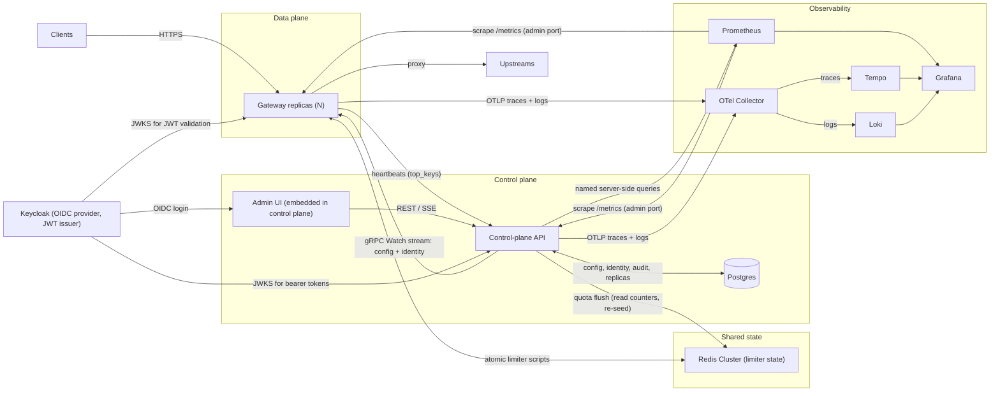

# Spillway — Distributed Rate Limiter + API Gateway: Requirements & Build Plan

Nov 2, 2026 · @Ankit Bisht

## Overview

Build Spillway, a horizontally scalable API gateway in Go with a Redis-backed distributed rate limiter, a Postgres-backed control plane, and a React admin UI. Targets: ≥ 10k rps per gateway vCPU, ≤ 5 ms p99 added latency, and limit accuracy proven by a test harness.

**Problem.** APIs need per-tenant fairness and protection from abuse and overload. Enforcing that correctly across many stateless replicas is hard: shared state, clock skew, contention, and failure of the shared store itself.

**Goals**

- Route and proxy HTTP traffic with production-grade resilience: timeouts, retry budgets, circuit breaking, health checking.
- Enforce rate limits and quotas globally across N replicas, with bounded and measured accuracy.
- Manage config through a versioned control plane that is never in the request path.
- Observe everything: metrics, traces, logs, dashboards, SLO alerts.
- Operate it from an admin UI: live traffic, policy authoring with shadow mode, rollback.

**Non-goals**

- Service mesh (sidecars, service-to-service mTLS everywhere).
- WAF, bot detection, request body inspection.
- Billing: quotas are enforced, not invoiced.
- GraphQL-aware limiting.
- Multi-region global limits: not built; an ADR documents the approach (per-region limits with asynchronous reconciliation).

**Success criteria** (what the README must prove)

- Throughput and added-latency benchmarks, reproducible from scripts in the repo and re-run nightly in CI.
- Accuracy report: admitted vs allowed per key, strict and batched modes, at 1, 3 and 5 replicas.
- Chaos report: behaviour under Redis loss, control-plane loss and gateway kill matches each policy’s documented failure mode.
- Deployed via Helm to a multi-node kind cluster, with dashboards and alerts as code.
- A scripted demo (`make demo`) of seven scenarios, plus README GIFs and a 3–4 minute walkthrough video.

## Architecture

Stateless gateway replicas form the data plane; a Go control-plane API over Postgres forms the control plane; Redis Cluster holds only rate-limit and quota state.



Gateways keep serving on their last good snapshot if the control plane is down; the UI’s live charts query Prometheus through the control-plane API. Prometheus scrapes metrics from the admin ports; traces and logs go over OTLP to the Collector, which forwards them to Tempo and Loki.

**Components**

| Component | Responsibility | State |
| --- | --- | --- |
| Gateway (Go) | Route, authenticate, rate-limit, proxy | In-memory config and identity snapshot; runtime registries (pools, breakers, local limiters; GW-29) |
| Redis Cluster | Global limiter state (GCRA timestamps, window counters), live quota counters | Ephemeral, every key TTL’d; `noeviction`, so a full node fails writes instead of resetting state (ADR-0004) |
| Control-plane API (Go) | Admin REST API, validation, versioning, config and identity stream to gateways, quota flusher, SSE fan-out; one active replica in v1 (CP-22) | Replica registry and heavy-hitter windows in Postgres; nothing in memory that can’t be rebuilt |
| Postgres | Source of truth: routes, upstreams, policies, plans, tenants, consumers, keys, access lists, overrides, quotas, replicas, heavy hitters, audit | Durable |
| Admin UI (React + TS) | Operate, author policies, manage consumers | None |
| Observability stack | OTel Collector, Prometheus, Tempo, Loki, Grafana | Telemetry |
| Keycloak (dev and demo) | OIDC provider for admin login; JWT issuer for gateway tests | Realm imported from `deploy/compose/keycloak/realm.json` |

**Request pipeline**

1. Accept the connection; terminate TLS; HTTP/1.1 or HTTP/2.
2. Generate or propagate the request ID; extract or start W3C trace context.
3. Match a route (host, method, path radix tree, headers).
4. Apply IP flood limits and the CIDR denylist (local; no identity needed).
5. Authenticate (API key or JWT); resolve consumer, tenant and plan.
6. Apply key and consumer allow and deny lists (RL-09).
7. Evaluate the other local limiters (concurrency, local-only policies).
8. Evaluate global limiters in Redis: the tenant-slot script (tenant → consumer → route levels), then the global level only if that allows (RL-14); multi-window, cost-weighted.
9. Check the upstream circuit breaker; pick an endpoint via the load balancer.
10. Proxy with per-try timeout; retries within the upstream’s retry budget.
11. Add RateLimit headers; record metrics, span and access log.

**Key design decisions**

- The data plane keeps serving on its last good config if the control plane is down.
- Limiter decisions use Redis server time, never gateway clocks.
- A tenant’s keys share one Redis Cluster hash slot, so its multi-level check is one atomic script.
- Accuracy vs latency is chosen per policy: strict (one Redis call per decision) or batched (token leasing).
- Failure behaviour is chosen per policy: fail-open, fail-closed, or degraded local limiting; readiness never depends on Redis (GW-24).
- Config is compiled into immutable snapshots and swapped atomically; runtime state (pools, breakers, limiter buckets) lives in registries that survive the swap (GW-29).
- Config is published as reviewed, versioned snapshots that can be rolled back; identity changes (keys, revocations, blocks, overrides) apply immediately with their own version and are never rolled back (CP-20, ADR-0005).

## Gateway (data plane)

The gateway is a stateless Go reverse proxy. Each requirement carries an ID (referenced by tests and milestones) and the milestone that delivers it.

### Routing and transforms

- **GW-01** (M1) Match routes on host, method, path (exact, prefix, `:param`) and header predicates via a radix tree; explicit priority breaks ties.
- **GW-02** (M1) Strip prefix, rewrite path, add or remove request and response headers per route.
- **GW-03** (M1) Enforce max body and header size per route; reject with 413 / 431.
- **GW-04** (M1) Serve HTTP/1.1 and HTTP/2 with TLS termination; certificates hot-reloaded from files.
- **GW-05** (Stretch) gRPC proxying and WebSocket passthrough.

### Upstreams and load balancing

- **GW-06** (M1) Upstream clusters with static endpoints; DNS names re-resolved on an interval.
- **GW-07** (M4) Load balancing: round robin, least-request with power-of-two-choices, consistent hash on a header or key.
- **GW-08** (M4) Active health checks: probe path, interval, healthy and unhealthy thresholds.
- **GW-09** (M4) Passive outlier detection: eject an endpoint after N consecutive 5xx or connect errors, with growing ejection time and a max-ejected-percent cap.
- **GW-10** (Stretch) Kubernetes Endpoints discovery.

### Resilience

- **GW-11** (M1) Timeouts per route: connect, per-try, overall, idle.
- **GW-12** (M4) Retries on connect failure and 502/503/504, idempotent methods only, exponential backoff with jitter.
- **GW-13** (M4) Retry budget per upstream (`retry_budget` on the upstream): retries ≤ 20% of requests over the last 10 s, plus a floor of 3 retries/s; routes set attempts only. Excess retries are dropped, not queued.
- **GW-14** (M4) Circuit breaker per upstream: max connections, max pending, max concurrent; error-rate state machine closed → open → half-open, tripping only once a window has at least `min_requests` (default 20); half-open lets `half_open_probes` (default 5) requests through before closing or reopening. An open circuit returns 503.
- **GW-15** (M4) Deadline propagation: remaining time budget sent upstream in a header.
- **GW-16** (Stretch) Hedged requests for idempotent GETs after the route’s p95 latency.

### Authentication

- **GW-17** (M2 static, M5 managed) API keys via header, stored as SHA-256 hashes (keys are high-entropy, so a fast hash is safe and lookups stay O(1)), cached in memory.
- **GW-18** (M5) JWT validation: RS256 / ES256 via cached JWKS, refetch on unknown `kid`, 60 s clock-skew leeway, `iss` / `aud` / `exp` / `nbf` checks. `iss` is checked against the configured, browser-facing issuer; JWKS is fetched from a separately configured URL, which in dev is the in-network address (ADR-0004).
- **GW-19** (M5) Identity resolution: key or token claims map to consumer, tenant and plan, which become rate-limit dimensions.
- **GW-20** (M5) Auth mode per route: none, API key, JWT, or either.

### Operations

- **GW-21** (M1) Config compiled into an immutable snapshot and swapped via `atomic.Pointer`; in-flight requests finish on the old snapshot.
- **GW-22** (M1) `X-Request-Id` generated or propagated; W3C `traceparent` propagated.
- **GW-23** (M4) Graceful shutdown: fail readiness, drain for a configured period, then exit.
- **GW-24** (M1) `/healthz` (liveness) and `/readyz` (config loaded and not draining). Redis state is never part of readiness: a Redis outage would pull every replica out at once; each policy’s failure mode handles it instead.
- **GW-25** (M1, M7 Kubernetes) Separate admin port for `/metrics` and `pprof`, bound to an internal interface. In Kubernetes, internal = the pod IP, not exposed by any Service or route; a NetworkPolicy admits only Prometheus and the kubelet.
- **GW-29** (M1 pools and health, M2 limiter state, M4 breakers and outlier state) Runtime state — connection pools, health and outlier state, circuit breakers, local limiter buckets and concurrency counters — lives in registries keyed by stable IDs and is reconciled on each snapshot swap, never owned by the snapshot. Test: a reload under load resets no bucket and no in-flight count.

### Self-protection

- **GW-26** (M4) Per-replica caps on open connections and in-flight requests; beyond them the gateway sheds load fast with 503 and `Retry-After` instead of queueing.
- **GW-27** (M1) `GOMAXPROCS` and `GOMEMLIMIT` follow the container’s CPU and memory limits, so the scheduler and GC behave under Kubernetes quotas.
- **GW-28** (M1) Server read-header, read, write and idle timeouts plus max header bytes, so slow clients cannot pin connections.

## Rate limiting

Limits are enforced per policy across all replicas through atomic Redis scripts; accuracy, latency and failure behaviour are configurable per policy.

### Algorithms

| Algorithm | State per key | Burst | Accuracy | Use for |
| --- | --- | --- | --- | --- |
| GCRA (token bucket) | 1 timestamp (TAT) | `burst`; defaults to `rate` for periods ≤ 1 min, required above (RL-03) | Exact: admitted in any window w ≤ burst + w·rate/period | Default per-second and per-minute limits |
| Sliding window counter | 1 hash `{w, cur, prev}` | Smoothed; no `burst` | Approximate: estimate ≤ limit at every admission; any true window ≤ 2 × limit | Per-minute and per-hour limits |
| Fixed window | 1 counter | Up to 2× at boundaries; no `burst` | Low: ≤ limit per aligned window | Local long windows; global day and month quotas are RL-10 |
| Concurrency | In-flight count | n/a | Exact: in-flight ≤ limit | Slow or fragile upstreams |

- **RL-01** (M2 local, M3 global) All algorithms implement one interface: `Allow(ctx, key, cost) → Decision{allowed, remaining, resetAfter, retryAfter}`.
- **RL-02** (M2) The concurrency limiter is local per replica (limit ÷ replicas, rounded down, minimum 1; see RL-31) and releases its slot on completion, timeout or client disconnect.

### Limit model

- **RL-03** (M2) A policy = level + match (routes, methods) + key template + one or more limits (rate, period, burst) + algorithm + mode + failure mode (`failure_mode`). `burst` is valid only for GCRA (validation rejects it elsewhere); it defaults to the limit’s `rate` for periods up to 1 minute and is required for longer periods (a default of `rate` would let a whole hour’s budget go in one instant); validation requires burst ≥ 1 and cost ≤ burst for every route–policy pair, since a larger cost could never be admitted.
- **RL-04** (M2) Key dimensions: IP (from `X-Forwarded-For` only behind trusted proxies), API key, consumer, tenant, route, method, any header; composite templates such as `{tenant}:{route}`.
- **RL-05** (M3) Hierarchical evaluation: each policy declares `level: global | tenant | consumer | route`, and a request must pass every applicable level. The tenant-slot script (tenant → consumer → route levels in one call) runs first; the global level is called only if that allows (RL-14).
- **RL-06** (M3) Multiple windows per policy (e.g. 100/s and 10k/h), all checked in one script call.
- **RL-07** (M3) Cost-based limiting: a route declares a cost (default 1) deducted per request.
- **RL-08** (M5) Plans (free, pro, enterprise) set default limits per policy (`default_limits` keyed by policy); a policy with `from_plan: true` (in place of `limits`) takes the consumer’s plan limits for that policy. Per-consumer overrides and time-boxed burst grants (overrides with an end time) take precedence; overrides are keyed by (consumer, policy) and allowed on consumer- and route-level policies only.
- **RL-09** (M5) Allowlists and denylists (`access_lists`) by key, consumer or CIDR, evaluated before limits: the CIDR denylist runs before authentication, key and consumer lists right after it (Request pipeline). Changes are identity changes (CP-20).
- **RL-10** (M7) Quotas (daily, monthly; UTC calendar days and months) are set per plan (`quotas: { daily, monthly }`, counted in route cost units), with per-consumer overrides, and counted in Redis per consumer and period. A control-plane flusher, one at a time under a Postgres advisory lock, reads the counters every 10 s and writes absolute values (`used = GREATEST(used, $n)`), so a repeated or late flush never double-counts. A per-tenant epoch marker detects lost Redis data: when it is missing, the flusher re-seeds that tenant’s counters from Postgres before counting resumes, and until then its quota checks follow the policy’s failure mode. Maximum under-count = one flush interval.

### Distributed correctness

- **RL-11** (M3) Each check is one Lua script (or Redis Function) call that reads, decides and writes atomically.
- **RL-12** (M3) Scripts read time from Redis `TIME`, so replica clock skew cannot change decisions. After a failover, `TIME` comes from the new primary’s clock; the bound is the clock offset between nodes (NTP-synced; documented).
- **RL-13** (M3) A tenant’s keys use the hash tag `{t:<tenant_id>}`, putting every tenant-scoped level in one Cluster slot and one atomic call. Tenant-, consumer- and route-level keys use the `{t:<tenant_id>}` of the request’s resolved tenant, whatever the key template. Global-level keys use `{g:<policy_id>}`, which spreads global policies across slots. `{k:<digest>}` is used only when the request has no tenant (for example IP limits on unauthenticated routes), and such a level is a separate call, like the global level. Key names carry a fixed-length digest of the filled key template, never raw API keys or header values (see Redis keys).
- **RL-14** (M3) The global level lives in other slots, so it is called only after the tenant-slot script allows; if the global level denies, the tenant-slot deductions are refunded.
- **RL-15** (M3) Every key has a TTL of at least its window plus burst time, so idle keys expire and memory stays bounded.
- **RL-16** (M3) Scripts are loaded once and called with `EVALSHA`, reloading on `NOSCRIPT` (the script never ran, so the reload is safe). Limiter calls are never retried once sent (`MaxRetries: 0` and `ContextTimeoutEnabled: true` on the limiter client), so a timeout can never deduct twice; a script test injects a timeout after execution and asserts a single deduction.
- **RL-29** (M3) Keys and scripts carry a schema version (`rl:v1:…`, one script SHA per version), so a rolling deploy that changes either runs old and new side by side instead of resetting or corrupting counters. While v1 and v2 keys run side by side the counters are split, so admission can reach 2× the limit for the rollout window; this bound is documented.
- **RL-30** (M3) Requires Redis 7 or later.

### Performance

- **RL-17** (M2) Local-only policies (e.g. IP flood limits) never touch Redis.
- **RL-18** (M7) Batched mode (token leasing): a replica reserves k tokens per key and serves them locally; over-admission ≤ replicas × k, with k set per policy.
- **RL-19** (M7) Deny cache (enforce mode only): after a deny with retry-after T, the replica denies that key locally for min(T, 10 s) without calling Redis. The cache is cleared on any config or identity version change.
- **RL-20** (Stretch) Coalesce concurrent checks on the same key into one script call (single-flight with summed cost).
- **RL-21** (M5) Heavy hitters: a Space-Saving sketch per replica tracks the top 100 throttled keys, shadow would-denies included, and reports them in each heartbeat’s `top_keys`; the control plane keeps them as `heavy_hitters` windows (CP-22).

### Failure handling

- **RL-22** (M3) Each request has one Redis time budget (default 5 ms total), split across its Redis calls; each Redis node has its own circuit breaker.
- **RL-23** (M3) Failure mode per policy: fail-open (allow), fail-closed (deny with 503), or degraded (local limiter at limit ÷ live replicas, rounded down, minimum 1).
- **RL-24** (M5) Live replica count comes from control-plane heartbeats (`live_replicas`: replicas whose last heartbeat is under 15 s old, three intervals); degraded mode uses the last known count.
- **RL-31** (M2) Until RL-24 lands, the replica count used by RL-02 and RL-23 comes from static config (`ratelimit.replicas`, default 1); from M5, heartbeats replace it, falling back to the last known count. Per-replica limits are limit ÷ replicas, rounded down, minimum 1.

### Responses and modes

- **RL-25** (M2) Denials return 429 with `Retry-After` (whole seconds, rounded up, minimum 1) and `RateLimit` / `RateLimit-Policy` headers per the IETF httpapi draft; allowed responses carry the headers too. An M2 ADR pins one revision of the draft (the latest at that time) with exact header syntax and test vectors.
- **RL-26** (M2) Mode per policy: enforce, shadow (decide and record, never reject), or off.
- **RL-27** (M2) Every decision records policy, decision and mode in metrics, and adds the key hash in the access log (keys never become metric labels, OB-01).
- **RL-28** (Stretch) Adaptive concurrency limiting from upstream latency (gradient or AIMD) with priority-based shedding.

## Control plane

Postgres holds every config and identity entity; the control plane validates and versions config changes and applies identity changes immediately, then streams both to gateways, which keep serving on the last good snapshot if it disappears (ADR-0005).

### Config model

- **CP-01** (M5) Entities, in two streams (ADR-0005). Config: upstreams (with endpoints), routes, policies, plans. Identity: tenants, consumers, API keys, access lists, overrides (incl. time-boxed burst grants).
- **CP-02** (M5) Config edits change working tables; a publish, with a change note, writes the full config as a snapshot with a new, monotonically increasing config version. Publish takes `If-Match` on the working-set revision shown in the diff preview (UI-02), so edits made after the preview can’t ship unreviewed.
- **CP-03** (M5) Validation before publish: schema, references (route → upstream; a policy still used by an override cannot be removed), regex compile, burst and cost rules (RL-03), policy conflicts (two policies at the same level matching the same route and method), and a dry compile of the gateway routing table.
- **CP-04** (M5) Rollback republishes an earlier config snapshot as a new config version and resets the config working tables to it; identity is never rolled back (CP-20).
- **CP-05** (M1 file, M5 API) Declarative YAML import and export of the full config, for GitOps and static mode.
- **CP-19** (M5) Postgres migrations (goose) run as a separate step (`controlplane migrate`): compose runs it before the API starts, Helm as a pre-install/pre-upgrade Job. Migrations stay backward compatible for one release (expand, then contract) so rolling deploys never break the running version.
- **CP-20** (M5) Identity changes (tenants, consumers, API keys, revocations, access lists, overrides, burst grants) are applied on every change with their own monotonically increasing identity version, audited, and never rolled back. They reach gateways on the same Watch stream as separate messages. Key revocation (CP-17) and one-click blocking (D7) go through identity (≤ 5 s).
- **CP-21** (M1) `api/proto/config.proto` is the single config schema from M1: YAML → JSON → proto (protojson), and the Postgres jsonb snapshot stores the same protojson form. `buf lint` and `buf breaking` run in CI from M1; CP-18 adds the compatibility rules in M5.

### Distribution

- **CP-06** (M5) Gateways open `ConfigService.Watch` with their replica ID and current config, identity and schema versions, and receive the full config snapshot when it changes and identity updates as separate messages. Diffs are deferred until snapshots exceed 1 MB.
- **CP-07** (M5) Gateways persist the last good snapshot to disk and boot from it when the control plane is unreachable. The read-only root filesystem gets a writable volume for it; with an emptyDir, a replacement pod started during a control-plane outage has no snapshot (documented in a runbook).
- **CP-08** (M5) Gateways heartbeat every 5 s, plus immediately when they apply a version, with their config and identity versions; the control plane records them in `replicas` and returns `live_replicas`. Staleness = time since the gateway last synced successfully (`gw_config_sync_age_seconds`); the UI shows it per replica.
- **CP-09** (M5) Propagation: p99 under 5 s from publish to applied on all replicas, measured from the immediate heartbeats.
- **CP-18** (M5) Snapshots carry a schema version. Gateways reject an unknown major version and keep the last good snapshot; the control plane serves gateways one minor version behind during rolling upgrades, and `buf breaking` in CI guards the proto.
- **CP-22** (M5) v1 runs one active control-plane replica (Helm `replicas: 1`; HA is stretch). Its state lives in Postgres — the `replicas` table and `heavy_hitters` windows (pruned after 7 days) — with nothing in memory that can’t be rebuilt. It also runs the quota flusher (under an advisory lock, RL-10) and SSE fan-out; a publish fires Postgres `LISTEN/NOTIFY` to wake the Watch streams.

### Admin API

- **CP-10** (M5) REST + JSON under `/api/v1`, OpenAPI-first: `api/openapi.yaml` is checked in, Go server stubs (oapi-codegen) and the UI client are generated from it, and `oasdiff` in CI guards it; the UI is its first-party client.
- **CP-11** (M5) Humans log in through Keycloak only (OIDC; “local accounts” are Keycloak users, GitHub brokered in the demo); service tokens are Keycloak confidential clients (client credentials). The control plane stores no passwords.
- **CP-12** (M5) RBAC: admin (everything), operator (policies, overrides, consumers, keys), viewer (read-only).
- **CP-13** (M5) Every mutation writes an audit record: actor, action, entity, before/after diff, timestamp, change note.
- **CP-14** (M5) Optimistic concurrency: updates require `If-Match` with the entity version.

### API key lifecycle

- **CP-15** (M5) Keys have 256 bits of entropy, are shown once, and are stored as SHA-256 hashes with a short visible prefix for identification.
- **CP-16** (M5) Rotation issues a new key with an overlap window during which both are valid.
- **CP-17** (M5) Revocation is an identity change (CP-20) and reaches every replica in ≤ 5 s; revoked keys get 401.

## Admin UI

A React + TypeScript single-page app over the admin API covers operating (traffic, health), authoring (policies backed by shadow-mode evidence) and managing (consumers, keys, history).

| Screen | Shows | Actions |
| --- | --- | --- |
| Overview | RPS, status mix, 429 rate (`reason="ratelimited"`), p50 / p99 latency per route and tenant, live | Filter by route, tenant, time range |
| Throttling | Top throttled keys (heavy hitters, RL-21), deny rate per policy | Add override, block key, open policy |
| Policies | Policies with level, mode, match, limits | Create and edit with validation, diff vs current, shadow report, promote shadow → enforce |
| Routes & upstreams | Route table, endpoints, health, ejections, circuit state | Edit routes, drain an endpoint |
| Consumers & keys | Tenants, consumers, plans, keys (prefix, created, expires, revoked); quota-usage column arrives with RL-10 in M7 | Issue, rotate, revoke keys; set overrides; edit allow and deny lists |
| Replicas | Gateway replicas, applied config and identity versions, staleness, last heartbeat | View only |
| History | Config versions, diffs, audit log | Roll back to a version |
| Playground (demo mode) | Allowed vs denied per tenant, `RateLimit` headers, token-bucket visual, live over SSE | Pick tenant and rate, fire traffic (generated server-side, UI-07), run a scenario |

- **UI-01** (M6) Shadow report: would-be-rejected count and share for a shadow policy over a chosen window, broken down by key from the heavy-hitter windows (RL-21).
- **UI-02** (M6) Diff preview before publish; the publish sends `If-Match` with the working-set revision the preview showed (CP-02), and every publish requires a change note, stored in the audit log.
- **UI-03** (M6) Live charts refresh every 5 s over SSE from the control plane, which runs named queries against Prometheus server-side; no PromQL in the browser.
- **UI-04** (M6) Role-aware UI: actions hidden or disabled per RBAC role, and enforced again server-side.
- **UI-05** (M6) Typed API client generated from the OpenAPI spec; server state via TanStack Query.
- **UI-06** (M6) Loading, empty and error states on every screen; large tables paginated server-side.
- **UI-07** (M8) Playground traffic is generated server-side: the control plane drives the real gateway in-network with short-lived demo keys, and the browser only shows results over SSE, so there are no cross-origin calls. Available only when `DEMO_MODE=true` (SC-08).
- **UI-08** (M6) Session model: OIDC code flow with PKCE; access token held in memory (never localStorage) with silent refresh; the API takes bearer tokens, so there is no cookie CSRF surface.
- **UI-09** (M6) The production UI build is embedded in the control-plane binary and served at `/`, same origin as `/api/v1`, so no CORS; in dev, the Vite server proxies `/api` to the control plane.

## Observability

Prometheus scrapes RED metrics, limiter decisions and dependency health from the gateway’s and control plane’s admin ports; traces and logs go over OTLP to the Collector, which forwards them to Tempo and Loki; dashboards and alerts ship as code.

| Metric | Type | Labels |
| --- | --- | --- |
| `gw_requests_total` | counter | route, method, code\_class, origin (gateway, upstream), reason (none, ratelimited, shed, circuit\_open, fail\_closed, upstream), tenant |
| `gw_request_duration_seconds` | histogram | route, tenant |
| `gw_upstream_duration_seconds` | histogram | upstream, attempt |
| `gw_ratelimit_decisions_total` | counter | policy, decision, mode |
| `gw_ratelimit_check_duration_seconds` | histogram | backend (local, redis) |
| `gw_redis_errors_total` | counter | kind (timeout, conn, script) |
| `gw_retries_total` | counter | upstream, outcome (sent, budget\_exhausted) |
| `gw_circuit_state` | gauge | upstream |
| `gw_upstream_endpoint_healthy` | gauge | upstream, endpoint |
| `gw_config_version`, `gw_identity_version` | gauge | none |
| `gw_config_sync_age_seconds` | gauge | none (time since the last successful sync with the control plane) |

- **OB-01** (M1) Cardinality control: consumer, key and raw path never become labels. Tenant is a label (on `gw_requests_total` and `gw_request_duration_seconds`) for the top 50 tenants by traffic; the rest report as `other`. The 429 rate is `gw_requests_total{reason="ratelimited"}`.
- **OB-02** (M4) Traces: OTel span per request, child spans for authn, each limiter check and each upstream attempt, sent over OTLP to the Collector and on to Tempo. Dev and demo sample 100% at the gateway and tail-sample in the Collector (keep errors, slow requests and a share of the rest); benchmarks use a fixed head ratio and no tail sampling.
- **OB-03** (M1) Access logs: one JSON line per request (request ID, trace ID, route, status, latency, decisions, key hash, bytes); sampled, but denials and 5xx always logged. `slog` writes JSON to stdout and, through an OTLP handler, to the Collector, which forwards to Loki.
- **OB-04** (M7) Grafana dashboards as JSON in the repo: Overview, Rate limiting, Upstreams, Redis, Control plane.
- **OB-05** (M7) Alert rules as code: multi-window SLO burn-rate alerts for availability and latency, Redis error rate, config sync stale > 60 s (`gw_config_sync_age_seconds`), circuit open > 5 min.
- **OB-06** (M7) Exemplars link latency histogram buckets to trace IDs, for sampled traces only.
- **OB-07** (M1) `pprof` and Go runtime metrics on the admin port.
- **OB-08** (M7) Every alert links to a runbook entry in `docs/runbooks/`: what it means, first checks, mitigation.

## Non-functional requirements

Every row has an ID (NFR-01 – NFR-15) and must be demonstrated by a benchmark or test in the repo: Measured by names how, First measured names the milestone whose exit check records it. Throughput targets are initial and get re-baselined after the first M1 benchmark.

| ID | Area | Target | Measured by | First measured |
| --- | --- | --- | --- | --- |
| NFR-01 | Throughput | ≥ 10k rps per gateway vCPU, 1 KB responses, no-op upstream | CI benchmark (manual from M1, nightly from M7), gateway pinned to 1 vCPU (see Benchmark method) | M1 (baseline) |
| NFR-02 | Scaling | Within 15% of linear from 1 to 2 gateway vCPUs | CI runner with CPU pinning: gateway on 1 then 2 vCPUs, loadgen 1, upstream 1, no Redis; valid only if loadgen hit its target rate | M7 |
| NFR-03 | Added latency, local limits | p99 ≤ 2 ms over direct-to-upstream | Paired runs with and without the gateway | M2 |
| NFR-04 | Added latency, Redis check | p99 ≤ 5 ms, Redis on the same host or zone | Same, with a global policy active | M3 |
| NFR-05 | Performance regression | No confirmed regression against the same-arch baseline or the last release’s baseline (same recorded CPU model only): a median throughput drop or p99 rise > 10% that also exceeds the baseline’s run-to-run spread, confirmed by one re-run | Nightly CI benchmark gate (see Benchmark method, ADR-0003) | M7 |
| NFR-06 | Accuracy, strict mode | GCRA: admitted in any window w ≤ burst + w·rate/period, per key; other algorithms meet their own bounds (Testing, Property) | Accuracy harness at 1, 3, 5 replicas | M3 |
| NFR-07 | Accuracy, batched mode | Over-admission ≤ replicas × k | Accuracy harness | M7 |
| NFR-08 | Config propagation | p99 < 5 s publish → applied on all replicas | Timestamps of the immediate heartbeat each replica sends on apply (CP-08) | M5 |
| NFR-09 | Key revocation | Rejected on all replicas < 5 s | Integration test (identity path, CP-20) | M5 |
| NFR-10 | Limiter keys | ≥ 1M active keys; ≤ 200 B Redis memory per key | Key-count sweep: Δ`used_memory` ÷ key count (not `MEMORY USAGE`) | M7 |
| NFR-11 | Availability | Gateway-caused 5xx ≤ 0.1% of requests (99.9% SLO) | `gw_requests_total{origin="gateway"}` 5xx with `reason` other than `shed`, `circuit_open`, `fail_closed` (deliberate; reported separately) | M7 |
| NFR-12 | Control-plane outage | Zero failed requests; config frozen at last good | Chaos test | M5 |
| NFR-13 | Redis outage | Each policy follows its failure mode within one Redis time budget | Chaos tests: full outage and killed primary (Chaos scenarios) | M3 |
| NFR-14 | Deploys and reloads | Zero failed requests during rolling restart and config reload | Load test during rollout on kind | M7 (config reload part from M1) |
| NFR-15 | Tenant isolation | One tenant at 10× its limit raises others’ p99 by < 10% | Noisy-neighbour test, from loadgen’s per-tenant histograms | M7 |

## Data model and interfaces

Four contracts carry the design: the Redis key and script contract, the Postgres schema, the config format shared by YAML, API and gateway, and the admin API.

### Redis keys

| Purpose | Key | Value | TTL |
| --- | --- | --- | --- |
| GCRA state | `rl:v1:{t:<tenant_id>}:<policy_id>:<period_ms>:<digest>` | TAT in µs | period + burst time |
| Sliding window | `rl:v1:{t:<tenant_id>}:<policy_id>:<period_ms>:<digest>` | hash `{w, cur, prev}` (window start, current and previous counts), rotated in the script using `TIME` | 2 × window |
| Global level | `rl:v1:{g:<policy_id>}:<period_ms>:<digest>` | as above, by algorithm | as above |
| No tenant on the request | `rl:v1:{k:<digest>}:<policy_id>:<period_ms>` | as above, by algorithm | as above |
| Quota | `q:v1:{t:<tenant_id>}:<consumer_id>:<period>` | count; `<period>` is the UTC day or month | period + 1 day |
| Quota epoch | `q:v1:{t:<tenant_id>}:epoch` | seed epoch, set when the flusher seeds the tenant’s counters; quota checks count only while it exists (RL-10) | longest quota period + 1 day, refreshed on every flush |

`<digest>` is base64url (unpadded, 22 characters) of the first 16 bytes of SHA-256 of the filled key template: fixed length, and raw API keys or header values never appear in key names. Keys use `policy_id`, so renaming a policy keeps its counters. In static mode (before M5) `policy_id` is the policy name; from M5 the control plane assigns stable IDs, so counters reset once when a deployment moves from static to managed config. Sliding-window state rotates inside its hash, so no limiter key name is derived from time.

### Limiter script contract

```
KEYS:    one key per limit in this slot
ARGV:    cost, then per limit: level, mode, algorithm, rate, period_ms, burst (0 unless GCRA)
RETURNS: allowed (0|1), denying_level, denying_limit, remaining, reset_after_ms,
         retry_after_ms, shadow_would_deny (bitmask per limit), now_us
```

The decision is the AND of the enforce limits. Within one call every limit is checked before any is written: enforce limits are written only if the request is allowed, and a shadow limit only if the request is allowed and that shadow limit would allow it, so an in-slot deny never needs a refund. A refund (RL-14) is the same script called with negative `cost`: it makes no decision and reverses only the limits the original call wrote, shadow limits included. `now_us` is the `TIME` the script used; the accuracy harness slides its windows over it. The tenant-slot call carries the tenant, consumer and route levels; the global level is a second call to the same script in its own slot (RL-14). GCRA and sliding-window maths, with t from Redis `TIME`:

```latex
\begin{aligned}
T &= \text{period} / \text{rate}, \qquad \tau = T \cdot \text{burst} \\
\text{TAT}' &= \max(\text{TAT},\ t) + c \cdot T \\
\text{allow} &\iff \text{TAT}' - t \le \tau, \qquad \text{retry\_after} = \text{TAT}' - \tau - t \\
\text{window estimate} &= \text{prev} \cdot \left(1 - \tfrac{\text{elapsed}}{\text{window}}\right) + \text{cur}
\end{aligned}
```

### Postgres schema (core tables)

| Table | Key columns |
| --- | --- |
| `config_versions` | id, published\_at, published\_by, note, working\_set\_revision, snapshot (jsonb, protojson config section) |
| `config_working_set` | revision (bumped by every config edit; publish’s `If-Match`), updated\_at |
| `routes` | id, name, priority, match (jsonb), upstream\_id, strip\_prefix, transforms (jsonb), size\_limits, auth\_mode, timeouts, retry (attempts), cost, version |
| `upstreams` / `endpoints` | id, name, lb, health\_check, circuit, retry\_budget, version / id, upstream\_id, address, weight, draining |
| `policies` | id, name, level, match, key\_template, limits (jsonb), from\_plan, algorithm, mode, failure\_mode, lease\_k, version |
| `plans` | id, name, default\_limits (jsonb, keyed by policy), quotas (jsonb: daily, monthly), version |
| `tenants` / `consumers` | id, name, plan\_id, status, version / id, tenant\_id, name, plan\_id (null = the tenant’s plan), status, version |
| `api_keys` | id, consumer\_id, prefix, hash, created\_at, expires\_at, revoked\_at |
| `access_lists` | id, action (allow, deny), subject\_type (key, consumer, cidr), subject, note, created\_at, version |
| `overrides` | id, consumer\_id, policy\_id (null for a quota override), limits, quotas, starts\_at, ends\_at (a burst grant has an end), version |
| `quota_usage` | consumer\_id, period, used (written as `GREATEST(used, $n)`), flushed\_at |
| `replicas` | id, config\_version, identity\_version, last\_heartbeat\_at |
| `heavy_hitters` | window\_start, policy\_id, key\_digest, consumer\_id, denied, shadow\_denied (pruned after 7 days) |
| `audit_log` | id, actor, action, entity, entity\_id, diff (jsonb), note, at |

The identity version is a Postgres sequence, bumped in the same transaction as each identity change. Every mutable entity table has a `version` column for `If-Match` (CP-14).

### Config format (YAML; same shape as a snapshot’s config section)

`api/proto/config.proto` is the one schema (CP-21): YAML is converted to JSON and parsed with protojson, and `config_versions.snapshot` stores the same protojson form. A snapshot has two sections, each with its own version: config (upstreams, routes, policies, plans), shown below, and identity (tenants, consumers, api\_keys with prefix + hash, access\_lists, overrides). Before M5 (static mode) both come from YAML files. Durations are strings in Go syntax (`200ms`, `1h`) and enum-like values are lower-case strings, both validated when the snapshot compiles, because protojson’s own `Duration` and enum forms would force `0.2s` and `AUTH_MODE_API_KEY` into the YAML. YAML is read with a YAML 1.2 parser (go-yaml v3), so `mode: off` stays a string.

```yaml
version: 42                      # config version
upstreams:
  - name: orders
    lb: p2c
    endpoints:
      - { address: 'orders-1:8080' }
      - { address: 'orders-2:8080', weight: 2 }
    health_check: { path: /healthz, interval: 5s, unhealthy: 3, healthy: 2 }
    circuit: { max_concurrent: 500, error_rate: 0.5, window: 10s, min_requests: 20, open_for: 30s, half_open_probes: 5 }
    retry_budget: { ratio: 0.2, min_per_sec: 3 }
routes:
  - name: orders-api
    match: { host: api.example.com, path_prefix: /v1/orders, methods: [GET, POST] }
    upstream: orders
    strip_prefix: /v1
    auth_mode: api_key
    timeouts: { connect: 200ms, per_try: 1s, total: 3s }
    retry: { attempts: 2 }        # conditions fixed by GW-12; budget on the upstream
    cost: 1
policies:
  - name: tenant-default
    level: tenant
    match: { routes: ['*'] }
    key_template: '{tenant}'
    algorithm: gcra
    limits:
      - { rate: 100, period: 1s, burst: 200 }
      - { rate: 10000, period: 1h, burst: 500 }  # required: period > 1 min
    mode: enforce
    failure_mode: degraded
    lease_k: 0
  - name: consumer-plan
    level: consumer
    match: { routes: [orders-api] }
    key_template: '{consumer}'
    algorithm: gcra
    from_plan: true              # limits come from the consumer's plan
    mode: shadow
    failure_mode: fail_open
plans:
  - name: free
    default_limits:
      - policy: consumer-plan
        limits: [{ rate: 10, period: 1s, burst: 20 }]
    quotas: { daily: 100000, monthly: 2000000 }   # RL-10, in route cost units
```

### Admin API (v1)

| Method | Path | Purpose |
| --- | --- | --- |
| GET, POST | `/api/v1/{routes,upstreams,policies,plans,tenants,consumers,overrides,access-lists}` | List, create |
| GET, PUT, DELETE | `/api/v1/<entity>/{id}` | Read, update (`If-Match`), delete |
| GET | `/api/v1/consumers/{id}/keys` | List keys: prefix, created, expires, revoked; never the key |
| POST | `/api/v1/consumers/{id}/keys` | Issue a key (returned once) |
| POST | `/api/v1/keys/{id}/rotate`, `/revoke` | Rotate, revoke |
| POST | `/api/v1/upstreams/{id}/endpoints/{eid}/drain` | Mark an endpoint draining in the working config (ships with the next publish) |
| GET | `/api/v1/config/export` | Full config and identity as YAML (CP-05) |
| POST | `/api/v1/config/import` | Replace the working set from YAML (CP-05); config still needs a publish |
| POST | `/api/v1/config/validate` | Validate working config; return errors, diff and the working-set revision |
| POST | `/api/v1/config/publish` | Publish working config as a new version (`If-Match`: working-set revision; change note required) |
| POST | `/api/v1/config/versions/{v}/rollback` | Republish an earlier version |
| GET | `/api/v1/config/versions`, `/{v}/diff` | History and diffs |
| GET | `/api/v1/policies/{id}/shadow-report` | Would-be denials over a window |
| GET | `/api/v1/replicas` | Replicas, applied config and identity versions, last heartbeat |
| GET | `/api/v1/metrics/query` | Named server-side Prometheus queries for the UI; never raw PromQL |
| GET | `/api/v1/stream` | SSE: live metrics, replica status, heavy hitters, Playground results (demo mode) |
| GET | `/api/v1/audit` | Audit log, paginated |

Config entities (routes, upstreams, policies, plans) change the working set until a publish; identity entities (tenants, consumers, keys, overrides, access lists) apply immediately (CP-20). The spec is `api/openapi.yaml`; Go server stubs (oapi-codegen) and the UI client are generated from it (CP-10).

Gateway ↔ control plane runs over gRPC: `ConfigService.Watch(WatchRequest{replica_id, config_version, identity_version, schema_version}) → stream Update` (a full config snapshot or an identity update) and `ConfigService.Heartbeat(Heartbeat{replica_id, config_version, identity_version, top_keys}) → HeartbeatResponse{live_replicas}`. Heartbeats go every 5 s, plus one immediately when a version is applied (NFR-08 is measured from those).

## Security

The gateway is an internet-facing edge, so defaults are closed: TLS on, admin surfaces internal-only, secrets never logged, every config change attributed. Each item carries the milestone that introduces its surface.

- **SEC-01** (M1) TLS 1.2+ with modern cipher suites on the traffic port; HSTS optional per route; a plain-HTTP listener exists only for local dev and benchmarks and is off by default.
- **SEC-02** (M1 admin port, M5 control plane and mTLS) Admin ports (gateway and control plane) and the gRPC config stream are bound to internal networks; the gateway ↔ control-plane stream uses mTLS. The control-plane REST API and embedded UI (UI-09) are internal by default in Helm; the public demo exposes them only through the tunnel, behind OIDC and RBAC. Compose publishes every port on `127.0.0.1` only.
- **SEC-03** (M2) API keys are looked up by key prefix, then the full digest is compared in constant time; keys are never logged; logs carry a key-hash prefix.
- **SEC-04** (M5) JWT algorithm allowlist (no `none`, no HS256 against public keys); `iss` checked against the configured issuer; JWKS fetched over TLS from the configured JWKS URL only. Plain-HTTP issuers and JWKS URLs are accepted only with `dev_mode: true` (compose, ADR-0004), never in Helm.
- **SEC-05** (M2) `X-Forwarded-For` trusted only from a configured proxy CIDR list, so clients cannot spoof IP-based limits.
- **SEC-06** (M1 YAML and dial, M5 API, M7 kind ranges) Upstream addresses checked against allowed networks to block SSRF through config, at config load and again at connection time via `net.Dialer.Control`, so DNS re-resolution (GW-06) cannot reach a blocked address; link-local and cloud metadata addresses always rejected. The dev allow-list includes the compose subnet; kind ranges are added in M7.
- **SEC-07** (M1) Hop-by-hop headers stripped; `X-Forwarded-*` set by the gateway; requests with both `Content-Length` and `Transfer-Encoding` are re-framed: `Transfer-Encoding: chunked` wins, `Content-Length` is dropped and the upstream receives the body with the gateway's own framing (RFC 9112 §6.3); differing `Content-Length` values are rejected with 400 and any `Transfer-Encoding` other than a single `chunked` with 501 (ADR-0009).
- **SEC-08** (M5) RBAC enforced server-side on every admin endpoint; audit log is append-only.
- **SEC-09** (M0, M5) Secrets (DB password, Redis auth, TLS keys) come from env or mounted files, never from config snapshots.
- **SEC-10** (M0) `govulncheck` and `pnpm audit` in CI; images run as non-root with a read-only root filesystem (the gateway gets a writable volume for its on-disk snapshot, CP-07).

## Testing and validation

Limiter maths is proven with a fake clock and property tests, distributed accuracy with a dedicated harness, and failure behaviour with scripted chaos runs whose results go in the README.

| Layer | What it proves | Tools |
| --- | --- | --- |
| Unit | Algorithm maths, route matching, retry budget, breaker transitions; test keys and certs are generated at test time, never committed | Go `testing`, fake clock |
| Property | Each algorithm against its own bound, for any arrival pattern: GCRA — admitted in any closed window w ≤ burst + w·rate/period; fixed window — ≤ limit per aligned window; sliding-window counter — the estimate is ≤ limit at every admission, and admitted in any true window ≤ 2 × limit; concurrency — in-flight ≤ limit | `rapid` |
| Fuzz | Router, header parsing and config validation never panic on hostile input | Go native fuzzing (`go test -fuzz`) |
| Script | Lua scripts on real Redis Cluster, incl. `TIME`, slots, the write rule and no retry once sent (a timeout injected after execution deducts once) | Compose Redis Cluster through the address-map Dialer (ADR-0004), locally and in CI |
| Integration | Gateway + Redis + Postgres + mock upstreams end to end | docker compose (Redis Cluster); testcontainers-go for Postgres and single-node cases |
| Contract | Proto and OpenAPI changes stay backward compatible | `buf breaking` (from M1), `oasdiff` (from M5) |
| Accuracy | Admitted vs allowed per key across 1, 3, 5 replicas | Custom Go harness (below) |
| Load | Throughput, added latency, scaling, regressions | `cmd/loadgen` (open model, HDR; fails a run below 99% of its target rate) for benchmarks, k6 for scenarios; results on the `bench-results` branch |
| Chaos | Failure modes, draining, outage survival | toxiproxy, `docker kill`, `docker pause` |
| UI | Screens and flows against a mocked API | Vitest, Testing Library, Playwright |

### Accuracy harness

1. Start N replicas (`gateway-1` … `gateway-5`; the harness runs in the compose network) behind a round-robin client with one policy (e.g. 1,000/s, burst 1,000) on M keys. The harness policy runs fail-closed.
2. Drive each key at 2× its limit for 60 s with three arrival patterns: uniform, bursty, and clustered at window boundaries.
3. Record every allowed response with the `now_us` the script returned for it (the gateway echoes it in a `Spillway-Decision-Time` response header only when `dev_mode: true`; in batched mode it echoes the lease’s `now_us` plus local time elapsed since the lease); slide a window w over those timestamps and count allowed per key against the algorithm’s own bound (Property row above).
4. Report max over-admission, mean admitted rate vs limit, and p99 decision latency, for strict and batched modes; any failure-mode admissions are reported separately. “Zero over-admission” (M3 exit) applies to GCRA in strict mode.

### Benchmark method

1. **Where:** GitHub Actions public-repo runners (4 vCPU, 16 GB) on two architectures, x64 `ubuntu-latest` and arm64 `ubuntu-24.04-arm`, each with its own baseline; manual trigger from M1, nightly from M7. Containers pinned with `--cpuset-cpus`: gateway 1 vCPU, load generator 2, Redis and mock upstream 1; scaling runs (NFR-02) use gateway 1 then 2 vCPUs, loadgen 1, upstream 1 and no Redis. Throughput runs use the plain-HTTP listener; TLS runs are labelled separately. A run is valid only if loadgen hit its target rate. Exploratory runs use the same layout on a laptop; every result records its hardware, including the CPU model.
2. **Load model:** open model at a constant arrival rate, never closed-loop, so slow responses cannot hide latency (coordinated omission). Latency goes into HDR histograms; report p50, p99 and p99.9.
3. **Protocol:** 30 s warm-up, 3 min measured, 5 runs; report the median and the spread.
4. **Regression gate:** results land as JSON on the `bench-results` branch (`results/<arch>/<UTC-timestamp>.json`); the baseline is the newest result for the same arch from a passing run on `main`, and each run is also compared against the last release’s baseline, which catches slow creep that no single night shows. Comparisons are made only between results with the same recorded CPU model. CI flags a run when its median shows a > 10% drop in throughput or rise in p99 and the change exceeds the baseline's run-to-run spread; a flagged run re-runs once and fails only if the re-run confirms it. Failed runs are stored but never become a baseline (ADR-0003). README numbers are updated by PR.

### Chaos scenarios

| Scenario | Injected via | Expected |
| --- | --- | --- |
| Redis latency +50 ms | toxiproxy (per-node proxies via the ADR-0004 address map) | Calls time out at the budget; each policy follows its failure mode |
| Redis full outage (all six nodes paused) | `docker pause` | Fail-open: ≥ 99.9% of requests allowed, each decided within one budget; fail-closed: 503 within one budget; degraded: each replica admits within ±10% of limit ÷ live replicas |
| Redis primary killed | `docker kill` | Only that primary’s slots degrade; failover window measured (expected ≈ `cluster-node-timeout` + election) and documented |
| Control plane down 10 min | `docker stop` | Zero failed requests; config-sync staleness alert fires |
| Gateway `kill -9` under load | signal | Only that replica’s in-flight requests fail |
| Upstream endpoint returns 5xx | fault-injecting mock | Outlier ejection; breaker opens; retries capped by budget |
| Rolling restart under load | `kubectl rollout restart` | Zero failed requests (preStop delay, `maxUnavailable: 0`) |
| Noisy tenant at 10× limit | load script | Other tenants’ p99 within 10% |

## Showcase

A reviewer should see the limiter earn its keep in under five minutes: `make demo` boots a fake multi-tenant API, and seven one-minute scenarios each prove a requirement on screen.

**Demo story.** “Acme API” is a mock orders API behind the gateway, with three tenants on free, pro and enterprise plans. A traffic simulator gives each tenant realistic base load; each scenario adds bursts, abuse or faults on top.

| # | Scenario | What the viewer sees | Proves |
| --- | --- | --- | --- |
| D1 | Fair limits by plan | Free tenant gets 429 with `RateLimit` headers at its limit; pro keeps flowing | RL-03, RL-08, RL-25 |
| D2 | Noisy neighbour | One tenant floods at 50× its limit; only it is throttled, others’ p99 stays flat | RL-05, NFR-15 |
| D3 | Distributed accuracy | 3 replicas behind a load balancer; allowed rate tracks the limit line exactly | RL-11 – RL-14 |
| D4 | Safe rollout | Stricter policy in shadow → report shows who would be hit → promote → roll back | RL-26, UI-01, CP-04 |
| D5 | Redis failure | Redis cut off (the full-outage case, via toxiproxy): fail-open keeps serving, fail-closed returns 503, degraded limits locally | RL-22 – RL-24 |
| D6 | Upstream protection | Upstream slowed: breaker opens, retries stay within budget | GW-13, GW-14 |
| D7 | Leaked key | Heavy hitters surface an abusive key; one click blocks it (an identity change, ≤ 5 s) | RL-21, RL-09, CP-20 |

- **SC-01** (M8) `make demo` boots the stack with seeded tenants, plans, keys and policies; `make demo-reset` restores it in one command.
- **SC-02** (M8) Traffic simulator `cmd/demo-traffic --scenario=d1…d7` drives base load plus each scenario’s bursts.
- **SC-03** (M8) Fault switches for D5 and D6 as `make` targets and Playground buttons, toxiproxy only: Redis traffic runs through per-node toxiproxy proxies via the ADR-0004 address map, and upstream latency is added in toxiproxy. Operator role only, `DEMO_MODE=true` only; no container gets the Docker socket.
- **SC-04** (M8) Playground screen in the admin UI (UI-07).
- **SC-05** (M8) Grafana Demo dashboard: allowed vs denied and p99 per tenant, limiter mode, replica count.
- **SC-06** (M8) README: architecture diagram, one GIF per scenario, benchmark, accuracy and chaos tables, a quick start of three commands or fewer.
- **SC-07** (M8) A 3–4 minute walkthrough video (D1, D2, D4, D5) and a live-demo script in `docs/demo.md`.
- **SC-08** (M8) Demo mode is off by default: Playground, demo endpoints and fault switches return 404 unless `DEMO_MODE=true`, and demo keys expire after 30 minutes with their own limits.
- **SC-09** (M8) Public demo: one reverse proxy (Caddy, port 8888) behind one tunnel — UI at `/`, Keycloak at `/auth`, Grafana at `/grafana`. `make demo-share` starts a quick tunnel and, from its URL, sets Keycloak’s `KC_HOSTNAME`, the control plane’s and gateways’ expected issuer (`<url>/auth/realms/spillway`), the UI’s OIDC authority and Grafana’s root URL, adds `<url>/*` to the `admin-ui` client’s redirect URIs and web origins through the Keycloak admin API, and restarts what changed; a named tunnel gives a stable link.

## Build plan

Nine milestones, each ending in a demoable state and an exit check. At 10–12 hours a week the core takes about 18.5 weeks; stretch work follows. Estimates are planning guesses, to be re-baselined after M1.

```mermaid
flowchart LR
  m0["M0 Foundations · 0.5 wk<br/>make dev boots healthy, ci-ok required"]
  m1["M1 Proxy core · 2 wk<br/>baseline recorded, reload drops nothing"]
  m2["M2 Local rate limiting · 1 wk<br/>each algorithm within its bound, shadow never rejects"]
  m3["M3 Distributed rate limiting · 2.5 wk<br/>GCRA strict: zero over-admission at 3 replicas"]
  m4["M4 Resilience · 2 wk<br/>≥ 99% success with a failing endpoint"]
  m5["M5 Control plane and auth · 3 wk<br/>publish applied everywhere in under 5 s"]
  m6["M6 Admin UI · 3 wk<br/>shadow, enforce, roll back from the UI"]
  m7["M7 Performance and hardening · 3 wk<br/>every NFR meets target or is re-baselined"]
  m8["M8 Showcase · 1.5 wk<br/>a newcomer reproduces every scenario"]
  stretch["Stretch"]

  m0 --> m1 --> m2 --> m3 --> m4 --> m5 --> m6 --> m7 --> m8
  m8 -.-> stretch

  classDef deferred stroke-dasharray: 5 5
  class stretch deferred
```



Each milestone leaves a working system; the checklists below map every task to its requirement IDs. Every milestone ships `make verify-m<n>`, which runs that milestone’s exit checks and prints each measured number with PASS or FAIL; its output goes in the description of the milestone’s last PR.

### M0 Foundations · est. 0.5 week

- [x] Single Go module `github.com/ankitbisht23/spillway` with pinned `go` and `toolchain` (CI and the Makefile set `GOTOOLCHAIN` to that exact version); pnpm workspace for `web/` with pinned `packageManager`, `.npmrc` save-exact and `.node-version` (ADR-0001, ADR-0002)
- [x] Makefile: `tools` (pinned sqlc, goose, golangci-lint, buf, gitleaks, oasdiff, govulncheck, protoc-gen-go, protoc-gen-go-grpc, oapi-codegen into `./bin`), `hooks`, `dev` (`docker compose up -d --wait` with `--env-file .env.example`, plus `--env-file .env.local` only if it exists), `test` (unit, property, short fuzz; no Docker), `test-integration` (compose + testcontainers), `lint`, `bench`, `verify-m0`
- [x] `compose.yaml` at the root, configs under `deploy/compose/`: Redis Cluster (3 primaries + 3 replicas), Postgres, Keycloak with realm import, Prometheus, Grafana with provisioned datasources, OTel Collector, Tempo, Loki, toxiproxy, mock upstreams; a healthcheck on every long-running service, and one-shot services (`redis-init`, `migrate`) must exit 0; images pinned to exact tags (digests at release); ports from `docs/ports.md`, published on `127.0.0.1` only; `ulimits.nofile` set; `.env.local` as an `env_file` entry with `required: false`
- [x] Dev networking (ADR-0004): Redis nodes `redis-0` … `redis-5` with `cluster-announce-hostname redis-N`, `cluster-preferred-endpoint-type hostname`, no persistence, `cluster-node-timeout 3000`, `maxmemory 256mb`, `maxmemory-policy noeviction` and `nodes.conf` on tmpfs; a one-shot `redis-init` service creates the cluster fresh on every `up`; Keycloak with `KC_HOSTNAME=http://localhost:8180/auth`, `KC_HTTP_RELATIVE_PATH=/auth` (the same path the demo proxy uses) and `KC_HOSTNAME_BACKCHANNEL_DYNAMIC=true`; Spillway processes join as compose services as they land
- [x] go-redis address-map Dialer for host-run processes and tests (`SPILLWAY_REDIS_ADDR_MAP`, dev and test only: `redis-N:6379` → `127.0.0.1:700N`), used by the `verify-m0` smoke write (ADR-0004)
- [x] `.env.example` with every variable and obviously fake dev-only defaults (e.g. `dev-only-not-secret`); secrets only from env or mounted files (SEC-09); `.gitleaks.toml` allowlists only the dev realm client secret, test-user passwords and `.env.example` defaults, and the scan is never weakened otherwise
- [x] CI on every PR, with one aggregate `ci-ok` job as the only required status check: golangci-lint, eslint, unit, integration (compose), fuzz smoke, `govulncheck`, `pnpm audit`, gitleaks, multi-arch image build running as non-root with a read-only root filesystem (SEC-10), and a job that boots `make dev` on `ubuntu-latest` and runs `make verify-m0`; Actions pinned to commit SHAs; Dependabot version updates (gomod, npm, github-actions, docker)
- [x] Docs in place: `docs/design.md`, `docs/setup.md`, `docs/ports.md`, `docs/adr/` (landed in the bootstrap commit; keep them current)

Exit (`make verify-m0`): `make dev` boots from a clean clone with every service healthy; `cluster_state:ok`; a smoke write from the host lands on all three primaries; the Keycloak realm’s OIDC discovery is reachable; Grafana datasources are provisioned; a CI job runs the same boot on `ubuntu-latest`; CI passes on a PR and `ci-ok` is the ruleset’s required check.

### M1 Proxy core · est. 2 weeks

- [x] Radix-tree router: host, method, path, headers (GW-01)
- [x] Reverse proxy on a tuned `http.Transport`: pooling, keep-alive, HTTP/2; pools and health state in registries keyed by stable IDs, reconciled on each snapshot swap (GW-04, GW-06, GW-29)
- [x] `make certs` (mkcert localhost cert into gitignored `deploy/certs/`) and the TLS listener with hot-reloaded certificates; plain-HTTP listener for dev and benchmarks only, off by default (GW-04, SEC-01)
- [x] Transforms, size limits, timeouts (GW-02, GW-03, GW-11)
- [x] Hop-by-hop headers stripped, `X-Forwarded-*` set by the gateway, requests with both `Content-Length` and `Transfer-Encoding` re-framed with `Transfer-Encoding: chunked` winning; differing `Content-Length` values rejected with 400, any other `Transfer-Encoding` with 501 (SEC-07, ADR-0009)
- [x] `api/proto/config.proto` as the one config schema: YAML → JSON → proto (protojson) → compiled snapshot → atomic swap on file change; `buf lint` and `buf breaking` in CI (GW-21, CP-05, CP-21)
- [x] Upstream allow-list checked at YAML load and at dial time via `net.Dialer.Control`; the dev list includes the compose subnet (SEC-06)
- [x] Request IDs, trace passthrough, JSON access logs (stdout and OTLP), RED metrics with `reason` and capped `tenant` labels, `/healthz` and `/readyz` (config loaded, not draining), admin port bound to an internal interface (GW-22, GW-24, GW-25, OB-01, OB-03, OB-07, SEC-02)
- [x] Server timeouts and container-aware runtime settings (GW-27, GW-28)
- [x] Gateway as compose services: `gateway-1`, plus `gateway-2` … `gateway-5` under the `replicas` profile; only `gateway-1` publishes host ports (ADR-0004)
- [x] `cmd/loadgen` v1: constant arrival rate (open model), HDR histograms, JSON results for `bench.yml`; reports achieved vs target rate and fails the run when achieved < 99% of target (saturated generator)
- [x] Fuzz tests for the router and config parser; `bench.yml` (manual trigger) on GitHub Actions; first baseline pushed to `bench-results` (NFR-01, ADR-0003)

Exit (`make verify-m1`): first load-test baseline recorded (NFR-01); config reload under load drops zero requests (NFR-14, reload part). The baseline comes from a run on `main` after the last M1 PR merges, so a small follow-up “M1 exit” PR records it; this is the one allowed exception to finishing a milestone’s exit check before the next starts.

### M2 Local rate limiting · est. 1 week

- [x] `Limiter` interface; in-memory GCRA, sliding window, fixed window, concurrency (RL-01, RL-02)
- [x] Local limiter buckets and concurrency counters in registries keyed by stable IDs; a reload under load resets no bucket and no in-flight count (GW-29)
- [x] Static replica count from config (`ratelimit.replicas`, default 1) for per-replica limits, rounded down, minimum 1 (RL-31)
- [x] Local-only policies (e.g. IP flood limits) that never touch Redis (RL-17)
- [x] Policies (level, match, key template, limits; `burst` GCRA-only, defaulting to `rate` for periods up to 1 minute and required above; burst ≥ 1 and cost ≤ burst validated), static API keys from YAML (RL-03, RL-04, GW-17)
- [x] Client IP from `X-Forwarded-For` only behind trusted proxy CIDRs (SEC-05, RL-04)
- [x] API keys looked up by prefix, digests compared in constant time, keys never logged (SEC-03)
- [x] 429 + RateLimit headers, `Retry-After` in whole seconds (rounded up, minimum 1); enforce, shadow, off; decision metrics (RL-25–RL-27)
- [x] ADR pinning one revision of the IETF RateLimit header draft, with exact header syntax and test vectors (RL-25)
- [x] Fake-clock unit tests and property tests, each algorithm against its own bound (Testing, Property)

Exit (`make verify-m2`): property tests pass for every algorithm against its own bound; shadow mode never rejects; added latency with local limits measured (NFR-03).

### M3 Distributed rate limiting · est. 2.5 weeks

- [ ] Global `Limiter` implementations as Lua scripts for GCRA and sliding window, per the script contract: multi-level, multi-window, cost, shadow write rule (RL-01, RL-05–RL-07, RL-11)
- [ ] Redis `TIME`, versioned hash-tagged keys with fixed-length digests, TTLs, `EVALSHA`, no retry once sent, Redis 7+ (RL-12, RL-13, RL-15, RL-16, RL-29, RL-30)
- [ ] Global level called after the tenant-slot script, with refunds; `{g:<policy_id>}` spreads global policies across slots (RL-14)
- [ ] One Redis time budget per request, a circuit breaker per Redis node, fail-open / fail-closed / degraded; degraded mode divides by the static replica count from M2 until heartbeats land in M5 (RL-22, RL-23)
- [ ] Accuracy harness v1 in the compose network against `gateway-1` … `gateway-5`; script tests on the compose Redis Cluster through the address-map Dialer (ADR-0004)
- [ ] Chaos tests: Redis full outage and killed primary, with the pass rules in Chaos scenarios
- [x] ADR: multi-region approach (non-goal; per-region limits with asynchronous reconciliation)

Exit (`make verify-m3`): GCRA in strict mode shows zero over-admission at 3 replicas (NFR-06); the Redis full-outage and killed-primary chaos tests meet their pass rules (NFR-13); added latency with a Redis check measured (NFR-04).

### M4 Resilience · est. 2 weeks

- [ ] Active health checks and outlier ejection; breaker and outlier state in registries that survive reloads (GW-08, GW-09, GW-29)
- [ ] Round robin, P2C least-request, consistent hash (GW-07)
- [ ] Retries with backoff; retry budget on the upstream (`retry_budget`: 20% of requests over 10 s, floor 3/s); deadline propagation (GW-12, GW-13, GW-15)
- [ ] Circuit breaker per upstream with `min_requests` and `half_open_probes`; graceful shutdown (GW-14, GW-23)
- [ ] Connection and in-flight caps with fast load shedding (GW-26)
- [ ] OTel tracing with a span per stage over OTLP: 100% at the gateway plus Collector tail sampling in dev and demo, a fixed head ratio for benchmarks (OB-02)

Exit (`make verify-m4`): with one of three endpoints failing, ≥ 99% of requests succeed within 10 s of the failure, retries stay within budget, and traces show each attempt.

### M5 Control plane and auth · est. 3 weeks

- [ ] Postgres schema; CRUD admin API, OpenAPI-first (`api/openapi.yaml`, oapi-codegen server stubs, `oasdiff` in CI), incl. tenants, access lists, key listing and endpoint drain (CP-01, CP-10, CP-14)
- [ ] Migrations as a separate `controlplane migrate` step: compose runs it before the API, Helm as a pre-install/pre-upgrade Job; expand, then contract (CP-19)
- [ ] YAML import and export through the API (CP-05)
- [ ] Validate, publish with a change note and `If-Match` on the working-set revision, version, rollback (config only); upstream allow-list checked in API validation (CP-02–CP-04, SEC-06)
- [ ] Identity changes applied immediately with their own version, audited, never rolled back, and sent on the Watch stream as separate messages (CP-20)
- [ ] gRPC Watch and Heartbeat (every 5 s plus immediately on apply), `replicas` table and `live_replicas`, `gw_config_sync_age_seconds`, on-disk last-good snapshot on a writable volume, versioned snapshot schema guarded by `buf breaking` (CP-06–CP-09, CP-18, RL-24)
- [ ] One active control-plane replica with its state in Postgres; `LISTEN/NOTIFY` on publish (CP-22)
- [ ] Heavy hitters in heartbeats’ `top_keys`, shadow would-denies included, kept as `heavy_hitters` windows (RL-21)
- [ ] mTLS for the gRPC stream: dev certs from `make certs`, certs from a Secret in Helm; control-plane API bound to internal networks (SEC-02)
- [ ] Key issue, list, rotate, revoke (revocation through identity); managed API keys from the control plane replace static ones (CP-15–CP-17, GW-17)
- [ ] JWT / JWKS with an algorithm allowlist, `iss` checked against the browser-facing issuer, JWKS from its own URL; identity → tenant and plan (GW-18–GW-20, SEC-04)
- [ ] Plans with `default_limits` per policy and `from_plan: true` policies, overrides keyed by (consumer, policy), allow and deny lists; Keycloak-only login with confidential clients for service tokens, RBAC on every endpoint, append-only audit log (RL-08, RL-09, CP-11–CP-13, SEC-08)
- [ ] Postgres, Redis and Keycloak secrets from env or mounted files (SEC-09)

Exit (`make verify-m5`): a publish reaches all replicas in < 5 s (NFR-08); a revoked key is rejected on all replicas in < 5 s (NFR-09); gateways serve unchanged through a 10-minute control-plane outage (NFR-12).

### M6 Admin UI · est. 3 weeks

- [ ] App shell embedded in the control-plane binary at `/`, Vite proxy in dev; OIDC login with in-memory tokens, role-aware navigation; typed client generated from `api/openapi.yaml` (UI-04, UI-05, UI-08, UI-09)
- [ ] Overview and Throttling screens with SSE live data from named server-side queries (UI-03)
- [ ] Policy editor: validation, diff, publish with `If-Match` on the previewed revision, shadow report, promote to enforce (UI-01, UI-02)
- [ ] Routes & upstreams, Consumers & keys (quota usage waits for M7), Replicas, History with rollback (UI-06)
- [ ] Vitest and Playwright tests for the main flows, run in CI from M6

Exit (`make verify-m6`): a new policy goes shadow → reviewed → enforced → rolled back entirely from the UI.

### M7 Performance and hardening · est. 3 weeks

- [ ] Token leasing; deny cache in enforce mode only, holding entries for min(retry-after, 10 s) and cleared on any config or identity version change (RL-18, RL-19)
- [ ] Quotas with the control-plane flusher: advisory lock, absolute writes, epoch marker and re-seed, UTC days and months; quota-usage column on Consumers & keys (RL-10)
- [ ] pprof-driven pass to cut hot-path allocations
- [ ] Nightly schedule and regression gate for `bench.yml`, against the same-arch baseline and the last release’s baseline, same CPU model only (NFR-05)
- [ ] Load tests against every NFR row (scaling on the CI runner, tenant isolation from loadgen’s per-tenant histograms); chaos suite; noisy-neighbour test (NFR-02, NFR-07, NFR-10, NFR-11, NFR-14, NFR-15)
- [ ] Helm chart `spillway` (gateway + control plane) on a 3-node kind cluster `spillway`; dependencies (Redis Cluster, Postgres, Keycloak, observability) as plain manifests in `deploy/kind/` using the same pinned images as compose, with Keycloak serving HTTPS (cert from a Secret) so the issuer and JWKS URLs are `https://` (SEC-04); `make kind-up` / `make kind-down`, and the Makefile always passes `--context kind-spillway`; dashboards, alert rules and runbooks as code (OB-04–OB-06, OB-08)
- [ ] kind specifics: no ingress controller — the gateway is the edge (NodePort + kind `extraPortMappings` on `127.0.0.1:443` → gateway; no port 80, the gateway serves no plain HTTP in Helm) with a preStop delay and `maxUnavailable: 0`; admin ports on the pod IP only, behind a NetworkPolicy that admits Prometheus and the kubelet (GW-25); kind ranges added to the upstream allow-list (SEC-06); control plane at `replicas: 1`; gateway snapshot on a writable volume, with a runbook for the emptyDir case
- [ ] README: architecture, benchmark, accuracy and chaos reports with reproduction steps
- [ ] Release v1.0.0: changelog, SBOM, signed multi-arch images `ghcr.io/ankitbisht23/spillway-gateway` and `ghcr.io/ankitbisht23/spillway-controlplane` (cosign keyless via GitHub OIDC)

Exit (`make verify-m7`): every NFR row (NFR-01 – NFR-15) meets its target, with the measured result in the README, or an ADR re-baselines it.

### M8 Showcase · est. 1.5 weeks

- [ ] Demo seed data, `make demo` and `make demo-reset` (SC-01)
- [ ] Traffic simulator and toxiproxy-only fault switches for D1–D7 (SC-02, SC-03)
- [ ] Playground screen with server-side traffic, and Grafana Demo dashboard (SC-04, SC-05, UI-07)
- [ ] Demo-mode guards and expiring demo keys (SC-08)
- [ ] Public demo: Caddy on 8888 behind one tunnel, `make demo-share` (SC-09)
- [ ] README GIFs (vhs for terminal scenes, a screen recorder for the UI), tables and quick start (SC-06)
- [ ] Walkthrough video and `docs/demo.md` live-demo script (SC-07)

Exit (`make verify-m8` runs D1–D7 and checks each): someone new to the repo runs `make demo` and reproduces every scenario from `docs/demo.md`.

### Stretch

- Adaptive concurrency limiting with priority shedding (RL-28)
- Envoy-compatible gRPC rate-limit service, so other proxies can use the limiter
- Hedged requests, gRPC and WebSocket proxying, Kubernetes discovery (GW-05, GW-10, GW-16)
- Single-flight coalescing of Redis checks (RL-20)
- Control-plane high availability (v1 runs one active replica)
- WASM plugin hooks for custom auth or transforms

## Repo layout, stack and tooling

One monorepo with a single Go module at the root (ADR-0002): Go binaries under `cmd/`, packages under `internal/`, the UI under `web/`, and deployment plus observability as code under `deploy/`.

```
spillway/
├── .claude/settings.json # agent permissions
├── .github/              # workflows/ (CI, bench.yml), dependabot.yml
├── cmd/
│   ├── gateway/          # data plane binary
│   ├── controlplane/     # admin API + config stream + embedded UI; `migrate` step
│   ├── loadgen/          # accuracy harness + open-model load driver
│   └── demo-traffic/     # showcase traffic simulator (D1–D7)
├── internal/
│   ├── router/           # radix tree, match compile
│   ├── proxy/            # transport, retries, deadlines
│   ├── resilience/       # breaker, outlier detection, budgets, load shedding
│   ├── ratelimit/        # Limiter interface, local algorithms
│   │   └── redis/        # versioned Lua scripts, client, failure modes
│   ├── auth/             # API keys, JWT / JWKS
│   ├── config/           # schema, validation, snapshot compile
│   ├── controlplane/     # store, handlers, publisher
│   └── telemetry/        # metrics, tracing, logging
├── api/                  # openapi.yaml (OpenAPI-first), proto/config.proto (the one config schema)
├── web/                  # React + TS admin UI (incl. Playground)
├── deploy/               # compose/ (service configs), kind/ (cluster + dependency manifests), helm/spillway/, grafana/, prometheus/
├── test/                 # integration/, chaos/, load/ (scripts; results on the bench-results branch)
├── docs/                 # design.md, setup.md, demo.md, ports.md, adr/, runbooks/
├── go.mod                # module github.com/ankitbisht23/spillway (no go.work)
├── compose.yaml          # dev stack; docker compose down -v from the root
├── Makefile              # incl. tools, dev, verify-m<n>
├── package.json, pnpm-workspace.yaml, .npmrc, .node-version   # pnpm workspace for web/ (ADR-0002)
├── CLAUDE.md
├── .env.example
├── .gitignore
├── .gitleaks.toml        # allowlists only fake dev values
├── LICENSE
└── README.md
```

| Concern | Choice |
| --- | --- |
| Backend language | Go, latest stable at M0: `go` and `toolchain` directives in `go.mod` (a minimum under `GOTOOLCHAIN=auto`); CI and the Makefile set `GOTOOLCHAIN` to the exact version |
| HTTP | `net/http` with a custom `http.Transport`; no framework |
| Redis | Redis 7+ Cluster via `go-redis` v9 |
| Postgres | `pgx` + `sqlc` for typed queries; `goose` migrations |
| RPC | gRPC for the config stream; `buf` for lint and breaking-change checks from M1 |
| Config and API schemas | `api/proto/config.proto` for config (protojson for YAML and jsonb); OpenAPI-first `api/openapi.yaml` with oapi-codegen server stubs and a generated UI client |
| Telemetry | Prometheus client (scraped from admin ports); OpenTelemetry SDK with OTLP for traces; `log/slog` with JSON to stdout plus an OTLP handler for logs |
| UI | React, TypeScript, Vite, TanStack Query and Router, Recharts or ECharts, pnpm |
| Identity (dev, demo) | Keycloak (OIDC, PKCE; JWT issuer for tests) |
| Testing | testcontainers-go, `rapid`, Go fuzzing, `cmd/loadgen`, k6, toxiproxy, Vitest, Playwright |
| Deploy | Docker, docker compose (every Spillway process as a compose service, ADR-0004), Helm, kind (gateway as the edge, no ingress controller) |
| Supply chain | Syft SBOM, cosign keyless signing, Dependabot, `govulncheck`, Actions pinned to SHAs, gitleaks |
| CI | GitHub Actions, one aggregate `ci-ok` required check: lint, unit, integration (compose), fuzz smoke, vuln scan (`govulncheck`, `pnpm audit`), gitleaks, multi-arch image build from M0; `buf lint` / `buf breaking` from M1; `oasdiff` from M5; UI tests from M6; nightly benchmark from M7 |
| Demo | vhs for terminal GIFs; Caddy reverse proxy behind a Cloudflare tunnel (quick or named) for live sharing |

Benchmarks run on GitHub Actions public-repo runners (x64 and arm64) with CPU pinning, manual from M1 and nightly from M7, and on a laptop for exploration; results go to the `bench-results` branch and every result records its hardware (see Benchmark method).

## Risks and open questions

The largest risks are Redis on the hot path and scope spread across three systems; exit checks gate each milestone so stretch work cannot crowd out M7 and M8.

| Risk | Impact | Mitigation |
| --- | --- | --- |
| Redis round-trip dominates added latency | Misses the 5 ms p99 target | Local limits first, deny cache, token leasing, pipelining |
| Lua scripts saturate a shard under contention | Rising tail latency, Redis CPU at limit | Keep scripts O(levels); benchmark ops/s per shard; spread global policies across slots; hot tenants use token leasing (RL-18) |
| Cross-slot refunds are not atomic | Brief over-deduction during denials | Document the bound; keep the global level optional |
| Scope spread across gateway, control plane, UI, demo | Project stalls before hardening and showcase | Exit checks per milestone; stretch list explicitly deferred |
| Shared CI runners are noisy | Numbers swing run to run | CPU pinning, 5 runs, median and spread, hardware recorded |
| Gateway, load generator and Redis share one 4-vCPU runner | Absolute rps understates a dedicated deployment | Report per-vCPU numbers; optional laptop or credit-funded runs for headline figures |
| Redis Cluster failover window | Burst of degraded decisions | Only the failed primary’s slots degrade; the killed-primary chaos test measures the window (≈ `cluster-node-timeout` + election); degraded local mode covers it |
| A Redis node reaches `maxmemory` | Limiter writes fail | `noeviction`, so state is never silently reset; write errors go through each policy’s failure mode and alert (ADR-0004) |
| Live demo depends on laptop and Wi-Fi | Interview demo fails | Recorded video and README GIFs as fallback |
| Agent output drifts from the design | Rework, inconsistent code | Plan first per task, requirement IDs in commits, PR review against exit checks |

**Open questions**

- [x] Project name and Go module path → `spillway`, `github.com/ankitbisht23/spillway` (ADR-0001)
- [ ] Concurrency limits: local per replica only, or also a global variant with leased slots in Redis?
- [ ] Quotas: is up to 10 s of under-count after a Redis loss acceptable?
- [ ] Should the Envoy-compatible rate-limit service move from stretch into M7?
- [ ] Is an always-on hosted demo worth AWS or Google Cloud credits, or are tunnel + video enough?

## Review — 2 Nov 2026

A review pass over this doc and the setup guide found 15 gaps; all are fixed in place. Decisions only you can make are in the open questions above.

| Gap | Fix | Where |
| --- | --- | --- |
| No plan for showing the limiter to a reviewer | Demo story, scenarios D1–D7, SC-01–SC-08, Playground, new M8 | Showcase, Admin UI, Build plan |
| Oracle Always Free unusable; M7 depended on a cloud VM | kind for Kubernetes, GitHub Actions for benchmarks, laptop + tunnel for demos; credits optional | Setup guide Steps 6–7 |
| Throughput target assumed dedicated 4-vCPU hosts | Per-vCPU target, benchmark method on CI runners, regression gate | Non-functional requirements, Testing |
| Load method could under-report tail latency | Open-model load, HDR histograms, median of 5 runs | Benchmark method |
| Gateway had no self-protection | Connection and in-flight caps, server timeouts, container-aware runtime (GW-26–GW-28) | Gateway |
| Rolling deploys could reset counters or break config | Versioned keys and scripts (RL-29, RL-30); snapshot schema versioning with `buf breaking` (CP-18) | Rate limiting, Control plane, Data model |
| Admin UI session model undefined | PKCE, in-memory tokens, bearer API (UI-08) | Admin UI |
| Alerts without operator guidance | Runbook per alert (OB-08) | Observability |
| No fuzz or contract tests | Fuzz and Contract layers | Testing |
| No release or supply-chain story | v1.0.0 with changelog, SBOM, cosign keyless signing | M7, Stack |
| Multi-region left implicit | Declared a non-goal, with an ADR | Overview |
| Agent could read SSH keys and lacked cluster permissions | Deny `~/.ssh/**`; allow kind, kubectl, helm, k6, `gh run` | Setup guide Step 9 |
| Claude plan usage limits not mentioned | Session sizing and plan note | Setup guide Step 9 |
| Public demo exposure risks | Demo-mode guards (SC-08), `KC_HOSTNAME`, `CF-Connecting-IP` trust | Showcase, Setup guide Step 7 |
| Scheduled benchmarks can silently pause | Re-enable note after 60 days of inactivity | Setup guide Step 6 |

## Second review — 2 Nov 2026

A pass over this doc, the setup guide and the repo bootstrap found 18 more gaps; all are fixed in place.

| Gap | Fix | Where |
| --- | --- | --- |
| SEC items had no milestone | Each SEC item tagged with its milestone(s) and added to those checklists | Security, Build plan |
| RL-17, CP-05 (API) and GW-17 (managed) missing from checklists | Added to M2 and M5 | Build plan |
| Replica count needed before heartbeats exist | Static `ratelimit.replicas` until heartbeats land (RL-31) | Rate limiting, M2, M3 |
| Keycloak missing from the design | Components row, architecture diagram, Stack row | Architecture, Stack |
| Bench timing mismatch; bench results could not be committed to protected `main` | `bench.yml` manual in M1, nightly with regression gate in M7; results on the `bench-results` branch per arch (ADR-0003) | Benchmark method, M1, M7, Stack |
| CI vuln scan named npm while the UI uses pnpm | `pnpm audit` | SEC-10, M0, Stack |
| Third-party HTTP load tool listed but never installed | Dropped; `cmd/loadgen` for benchmarks and the accuracy harness, k6 for scenarios | Testing, Stack |
| NFR rows untraceable | IDs NFR-01 – NFR-15 with a First measured milestone, cited in exit checks | Non-functional requirements, Build plan |
| M0 checklist thinner than the setup guide | M0 rewritten: pinned module and pnpm workspace, Makefile targets, compose layout, `.env.example`, CI, docs | M0 |
| Multi-region ADR unassigned | ADR task in M3 | M3 |
| mTLS cert issuance undefined | `make certs` dev certs; certs from a Secret in Helm (SEC-02) | M5 |
| Diagrams lost in export | Redrawn as Mermaid | Architecture, Build plan |
| Single module vs multi-module layout undecided | One module at the root, no `go.work` (ADR-0002) | M0, Repo layout |
| Compose file location vs `docker compose down -v` | `compose.yaml` at the root, service configs under `deploy/compose/` | M0, Repo layout |
| UI hosting undefined | Embedded in the control-plane binary, same origin as the API (UI-09) | Admin UI, M6 |
| Migrations on deploy undefined | Separate `controlplane migrate` step, expand then contract (CP-19) | Control plane, M5 |
| Helm dependencies undefined | Chart covers gateway + control plane; dependencies as plain manifests in `deploy/kind/` | M7, Repo layout |
| Name and module undecided | `spillway`, `github.com/ankitbisht23/spillway`, MIT (ADR-0001) | Title, Open questions |

## Third review — 2 Nov 2026

An adversarial review of the build plan found 23 more gaps in this doc; all are fixed in place, with two new ADRs (0004, 0005).

| Gap | Fix | Where |
| --- | --- | --- |
| Redis Cluster unreachable from host processes; Keycloak issuer differs inside and outside Docker | Every process in compose, address-map Dialer for host runs, hostname-announcing nodes, dev Keycloak settings (ADR-0004) | M0, SEC-04, SEC-06, Testing |
| Exit checks not runnable; M1 baseline needs a merged `main` | `make verify-m<n>` per milestone; detailed M0 exit; follow-up “M1 exit” PR | Build plan |
| One accuracy bound applied to every algorithm | Per-algorithm property bounds; `burst` GCRA-only; harness uses script `now_us`, fail-closed policy | Testing, M2, M3, NFR-06 |
| Redis keys leaked raw values and were time-derived; shadow writes undefined | Digest keys with `{t:}`, `{g:}`, `{k:}` tags; hash-based sliding window; script contract and write rule; 2× bound during key-version rollouts | Data model, RL-13, RL-29 |
| Rollback could un-revoke keys; publish could ship unreviewed edits | Separate config and identity streams (CP-20); publish `If-Match` on the previewed revision (ADR-0005) | Control plane, UI-02 |
| Config schema defined four times | `config.proto` as the one schema from M1 (CP-21); access lists, tenants, key listing, drain endpoints; OpenAPI-first in M5 | Control plane, Data model, M1, M5 |
| No load generator until it was needed | `cmd/loadgen` v1 in M1, failing runs below 99% of target | M1 |
| Limit hierarchy and its Redis calls undefined | Tenant-slot script first, then global; one time budget per request; `level` and `from_plan`; override and conflict rules | RL-05, RL-08, RL-14, RL-22, CP-03 |
| Readiness tied to Redis; retries could double-deduct; chaos pass rules vague | `/readyz` without Redis (GW-24, M1 only); no retry once sent; breaker per node; full-outage and killed-primary tests with numbers | GW-24, RL-16, RL-22, Chaos, M3, D5 |
| Reloads could reset runtime state | Runtime registries outside snapshots (GW-29) | Gateway, M1, M2, M4 |
| GCRA defaults and 429 format loose | `burst` defaults to `rate` up to 1-minute periods, required above; burst ≥ 1, cost ≤ burst; pinned header draft ADR; `Retry-After` rounding | RL-03, RL-25, M2 |
| UI screens needed data nobody produced | Heavy hitters in M5 via heartbeats; `reason` and `tenant` labels; named queries only | RL-21, Observability, Admin UI, NFR-15 |
| Control-plane state and gRPC messages undefined | One active replica, state in Postgres (CP-22); Watch and Heartbeat messages; `gw_config_sync_age_seconds` | Control plane, Data model, OB-05 |
| Telemetry paths and sampling inconsistent | Prometheus scrapes admin ports; OTLP for traces and logs; sampling per environment | Architecture, OB-02, OB-03, OB-06, Stack |
| Local accounts implied a password store | Keycloak-only login; service tokens as confidential clients | CP-11 |
| Required checks and gitleaks allowlist undefined | One `ci-ok` check; CI scope per milestone; narrow `.gitleaks.toml` | M0, Stack |
| SSRF check bypassable by DNS; pipeline order vague | Dial-time allow-list check; deny lists before and after auth | SEC-06, Request pipeline, RL-09 |
| Retry budget and breaker parameters undefined | `retry_budget` on the upstream; `min_requests`, `half_open_probes`; numeric M4 exit | GW-13, GW-14, Config format, M4 |
| Quota flush could double-count or miss lost data; deny cache scope unclear | Absolute flush under an advisory lock, epoch re-seed, UTC periods; deny cache enforce-only, capped, cleared on version change | RL-10, RL-19, Data model |
| NFR measurements underspecified | NFR-02 on CI, release-baseline gate, same CPU model, NFR-11 SLI, re-baseline rule, kind edge | NFR table, Benchmark method, M7, ADR-0003 |
| Demo needed the Docker socket and cross-origin calls | Server-side Playground traffic; toxiproxy-only faults; one Caddy proxy behind one tunnel (SC-09) | UI-07, SC-03, Showcase, M8 |
| `make tools` list incomplete | Adds govulncheck, protoc-gen-go, protoc-gen-go-grpc, oapi-codegen | M0, ADR-0002 |
| Small ambiguities | Prefix lookup + constant-time digest compare; rounding of limit ÷ replicas; failover clock bound; snapshot volume; Kubernetes admin port; NFR-10 method | SEC-03, RL-02, RL-12, RL-23, RL-31, CP-07, SEC-10, GW-25, NFR-10 |
